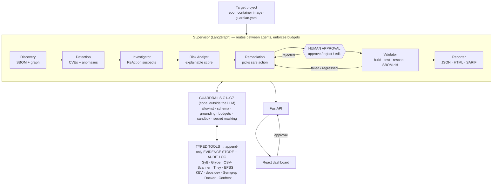
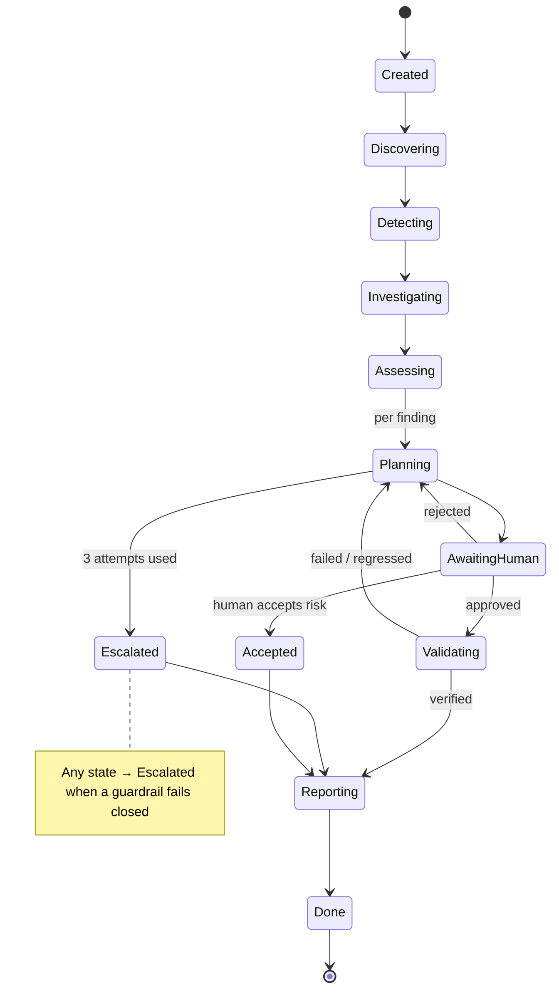

# GUARDIAN — Software Supply Chain Guardian
## Master Plan & Single Source of Truth (v1.0)

> **Status:** Approved team plan, v1.0 (2026-11-23).
> **Rule:** If anything in code, chat or another doc disagrees with this file, **this file wins**. Changes to it go through a PR (see §14.6).
> **Audience:** All 5 developers **and their AI coding assistants** (Claude Code etc.). AI assistants: read §0 first.

---

## Table of contents

0. [Instructions for AI coding assistants](#0-instructions-for-ai-coding-assistants)
1. [The problem we are solving](#1-the-problem-we-are-solving)
2. [What the judges are scoring (our reading)](#2-what-the-judges-are-scoring-our-reading)
3. [Our solution in one page](#3-our-solution-in-one-page)
4. [Design principles](#4-design-principles)
5. [Architecture](#5-architecture)
6. [Agents](#6-agents)
7. [State machine](#7-state-machine)
8. [Shared contracts (data model, tools, adapters, API)](#8-shared-contracts)
9. [Guardrails G1–G7](#9-guardrails-g1g7)
10. [Risk scoring & confidence](#10-risk-scoring--confidence)
11. [Generality: ecosystem adapters](#11-generality-ecosystem-adapters)
12. [Tech stack & why](#12-tech-stack--why)
13. [Repository structure & ownership](#13-repository-structure--ownership)
14. [GitHub strategy](#14-github-strategy)
15. [Team, roles & task breakdown](#15-team-roles--task-breakdown)
16. [Timeline & integration milestones](#16-timeline--integration-milestones)
17. [Demo target: OWASP Juice Shop facts](#17-demo-target-owasp-juice-shop-facts)
18. [Demo script](#18-demo-script)
19. [Failure modes](#19-failure-modes)
20. [Deliverables checklist](#20-deliverables-checklist)
21. [Risks, open questions & things to verify](#21-risks-open-questions--things-to-verify)

---

## 0. Instructions for AI coding assistants

If you are an AI coding assistant working in this repo, follow these rules exactly.

1. **Ask which developer you are working for** (Dev1–Dev5) if it is not stated. Your tasks are in §15 under that developer.
2. **Read before coding:** §3, §4, §8 (contracts), §9 (guardrails), §13 (ownership), §14 (Git rules), then your task cards in §15.
3. **Only modify paths your developer owns** (§13 ownership table). If you need a change elsewhere, write it in the PR description under "Requests to other owners", do not make it.
4. **Never change contract files** (`guardian/core/models.py`, `guardian/tools/base.py`, `guardian/adapters/base.py`, `guardian/api/schemas.py`, `ui/src/api/types.ts`) unless your task says so. Contract changes follow §14.6.
5. **Work one task card at a time.** Each card has: ID, goal, files, depends-on, steps, acceptance criteria. A task is done only when every acceptance criterion passes.
6. **Tests are mandatory.** Every task adds or updates tests under `tests/` (or `ui/src/**/*.test.tsx`). Run `make check` before proposing a commit.
7. **Do not invent tool flags or library APIs.** When unsure whether a CLI flag or a function exists, check the tool's `--help` / current docs and say what you checked. Lines marked **⚠ VERIFY** in this doc are known to need checking.
8. **Security rules apply to you too:** no real secrets in code, no network calls outside the allowlist in §9 G3.5, no `subprocess` with `shell=True`, no pushing, publishing or merging.
9. **Branch & commit** per §14 (`devN/TASK-ID-short-name`, Conventional Commits with the task ID).
10. If a task card is ambiguous or blocked, **stop and report** what is missing. Don't guess.

Suggested first prompt for each developer:
> "I am DevN on the Guardian project. Read GUARDIAN_PLAN.md §0, §3, §8, §9, §13, §14 and my task cards in §15. Start with task DN-01. Show me your plan before writing code."

---

## 1. The problem we are solving

**Problem statement (Bosch):** Build an Agentic AI solution that continuously analyses the software supply chain to identify dependency risks, vulnerabilities and suspicious changes before they impact applications.

**Why it is hard:** modern apps are assembled from open-source libraries, transitive dependencies, container images, build tools and CI components that change constantly. Scanners find known CVEs, but teams still need to know:
- which risks **actually matter** (reachable? exploitable? in production?),
- **what changed** in the supply chain,
- how to **remediate safely**, and
- proof that the fix **worked and broke nothing**.

**Required flow (from the brief):** `Discover → Detect → Analyze → Remediate → Validate`

**Day 1 (visibility):** manifests/lockfiles → direct + transitive deps → SBOM (CycloneDX/SPDX) → dependency graph → ≥1 container image or CI workflow inspected → CVEs with severity + fix → ≥1 supply-chain anomaly → evidence (what, which component, dependency path, evidence, initial risk).
> Checkpoint: *"Show us what is in the application, what changed, and what appears risky."*

**Day 2 (brain & shield):** prioritise (severity + exploitability + reachability + exposure + prod use) with explainable score + confidence → investigate ≥1 non-CVE risk, separating verified evidence from AI inference → recommend remediation (upgrade/replace/pin/update base image/block/escalate, with risk reduction, compatibility impact, rollback) → validate in sandbox (build, unit+integration tests, rescan, SBOM diff, detect new problems) → report.
> Final demo: *"Show us how the Guardian takes a finding from detection to verified remediation."*
> Expected flow: `Prioritized Risk → Recommended Fix → Human Approval → Build & Test → Rescan → Verified Remediation`

**Out of scope (hard rules — violating them loses points):**
- Scanning/attacking real production systems.
- Accessing repos/registries/infrastructure outside our authorised sandbox.
- Publishing malicious or modified packages to public registries.
- Exposing or using real credentials, secrets or tokens.
- Auto-merging, deploying or releasing remediation without human approval.
- Anything that impacts other teams or shared infrastructure.

**Instructor requirement:** the solution must be **general** — it should work for any project (any language, any kind of app), not only for the website we demo on.

---

## 2. What the judges are scoring (our reading)

1. **Completeness first:** "Core capabilities demonstrate completeness. Stretch goals demonstrate innovation." A full working loop beats a clever partial one.
2. **Beyond scanners:** context (reachability, prod vs dev, exploitability), non-CVE risks, verified-vs-inferred separation.
3. **Safe action:** human approval, sandbox, rollback, no secrets — made **visible** in the demo.
4. **Verified protection:** before/after evidence that the fix reduced risk and introduced nothing new.
5. **Agentic:** agents that *decide*, *investigate* and *re-plan* — not a fixed script.
6. **Generality:** the same system on a second, different project.
7. **Deliverables:** prototype, architecture diagram, source + setup, live demo, Guardian Report (human + machine readable), Responsible AI & Security note.

---

## 3. Our solution in one page

**Guardian** is an ecosystem-agnostic, multi-agent system (LangGraph) that turns any repository + container image into an SBOM and dependency graph, detects CVEs and non-CVE supply-chain anomalies, lets agents investigate and prioritise them with an explainable, evidence-backed score, proposes a remediation, **waits for human approval**, validates the fix in a disposable sandbox (build → test → rescan → SBOM diff), re-plans if validation fails, and produces a Guardian Report in JSON, HTML and SARIF.

**Core idea:** *Tools produce facts. Agents make decisions and explanations. Humans approve changes. Guardrails in code sit between agents and tools.*

**Why it wins:**
- **Grounded:** every claim cites an evidence ID; unsupported claims are labelled `INFERRED`, never `VERIFIED`. LLMs never invent versions, CVEs or package names (enforced in code).
- **Agentic where it matters:** a Supervisor routes, an Investigator runs a tool-using ReAct loop on suspicious findings, the Remediation agent **re-plans after a failed validation** (our demo highlight).
- **General:** the core only sees CycloneDX SBOMs + package URLs (purl). Ecosystems plug in as adapters. Demoed on Juice Shop (npm) **and** a second project in another ecosystem.
- **Works without the LLM:** `--no-llm` still produces findings, scores and validation — the LLM adds investigation and judgement on top.

**Stretch goals we commit to (in order):** ① Policy-as-code (OPA/Conftest) ② Reachability (tiered) ③ Automated remediation branch + PR in a local forge/fork. Bonus if time: Cosign signing of the validated image.

---

## 4. Design principles

1. **Tools produce facts; agents produce decisions and explanations.** No version number, CVE ID or package name may originate from an LLM.
2. **Every claim cites evidence.** No evidence ID → label `INFERRED`.
3. **Core is ecosystem-blind.** Only adapters know npm/Maven/pip/Go. Components are identified by **purl** (e.g. `pkg:npm/express-jwt@0.1.3`).
4. **Agents act only through typed tools.** No free-form shell. Each tool has a schema, an allowlist entry and a budget.
5. **Nothing changes the target without a human.** Every code change passes the approval gate.
6. **Fail closed.** Missing evidence, invalid output or exhausted budget → degrade or `ESCALATE`, never guess.
7. **Replayable.** Append-only audit log reconstructs every decision.

---

## 5. Architecture

### 5.1 Layers

| Layer | Responsibility | Tech |
|---|---|---|
| **Agent layer** | Decide what to do next, which tools to call, what evidence means | LangGraph + LangChain chat models |
| **Guardrail layer** | Allow / block / rewrite every agent action before it runs | Python, in-process (`guardian/guardrails/`) |
| **Tool layer** | Wrap external tools with typed args; the only layer that creates Evidence | LangChain tools + subprocess wrappers |
| **Evidence store + audit log** | Append-only facts, decisions, approvals; source of the report | SQLite (SQLModel/sqlite3) + raw files under `runs/<run_id>/raw/` |
| **API** | Runs, findings, approvals, reports, live events | FastAPI |
| **UI** | Graph, findings, evidence, approval, before/after | React + Vite + TS + Tailwind + React Flow |
| **Sandbox** | Disposable build/test environment per validation attempt | Docker |

### 5.2 Architecture diagram



### 5.3 Data flow (one finding, end to end)

1. `POST /runs` creates a Run → Supervisor starts.
2. Discovery: adapters detect ecosystems → `sbom_generate` (repo) + `image_sbom` (image) → Evidence(SBOM) → `graph_build` → dependency paths.
3. Detection: `vuln_scan_grype` + `vuln_scan_osv` + `image_scan_trivy` + detectors → Findings (each cites ≥1 Evidence).
4. Investigator (suspicious non-CVE findings only): loops over registry metadata / version diff / file excerpts until sufficient or budget hit.
5. Risk Analyst: `epss_lookup`, `kev_lookup`, reachability → `scoring.compute()` → LLM writes claims with evidence IDs → grounding validator labels each claim.
6. Remediation: `safe_version_lookup` → LLM chooses action → `adapter.render_patch` → RemediationPlan.
7. LangGraph **interrupt** → UI shows plan → human approves → Approval record.
8. Validator: fresh container → apply patch → build → tests → SBOM → rescan → diff → ValidationResult (`verified` / `failed` / `regressed`).
9. Failed → back to Remediation (max 3 attempts) → else Escalated. Verified → Reporter.

---

## 6. Agents

| Agent | Input | Output | Allowed tools | Budget (default) | LLM? | Decides |
|---|---|---|---|---|---|---|
| **Supervisor** | Run state | next node | none | 40 transitions/run | Light (or rule-based fallback) | Which agent next; when to stop |
| **Discovery** | Run target | SBOM + graph Evidence | `ecosystem_detect`, `sbom_generate`, `image_sbom`, `graph_build`, `ci_parse`, `dockerfile_parse` | 10 calls, 10 min | Optional | Which adapters/generators apply |
| **Detection** | SBOM, graph | `Finding[]` | `vuln_scan_grype`, `vuln_scan_osv`, `image_scan_trivy`, `detector_*` | 15 calls, 10 min | Optional | Which detectors are relevant |
| **Investigator** | one suspicious Finding | updated Finding + Evidence | `registry_metadata`, `deps_dev_lookup`, `file_read`, `version_diff`, `sbom_diff` | 8 calls/finding | **Yes (ReAct)** | When evidence is sufficient |
| **Risk Analyst** | Finding + Evidence | `RiskAssessment` | `epss_lookup`, `kev_lookup`, `reachability_import`, `reachability_semgrep` | 5 calls/finding | **Yes** | Whether to run reachability; exposure judgement |
| **Remediation** | RiskAssessment (+ last ValidationResult on retry) | `RemediationPlan` | `safe_version_lookup`, `adapter_render_patch` | 3 attempts/finding | **Yes** | Which action; how to re-plan |
| **Human gate** | RemediationPlan | `Approval` | UI only | waits (checkpointed) | — | approve / reject / edit |
| **Validator** | approved plan | `ValidationResult` | `sandbox_create`, `apply_patch`, `build`, `test`, `sbom_generate`, `vuln_scan_grype`, `sbom_diff`, `policy_check` | 1 sandbox/attempt, 20 min | No | nothing (deterministic) |
| **Reporter** | all run entities | report JSON/HTML/SARIF | `template_render` | 1 call | Light (summary) | nothing (summarises existing claims) |

**Contract rules**
- Agent output is parsed into its Pydantic type. Parse failure → one repair retry with the validation error → then `ESCALATE`.
- The orchestrator (not the agent) checks the tool allowlist and counts budgets.
- Temperature 0 for Risk Analyst and Remediation.
- On budget exhaustion: keep partial result, `confidence = Low`.

---

## 7. State machine



**Termination rules**
1. Run ends when every finding at/above the reporting threshold (default: Medium) is Verified, Accepted or Escalated.
2. Max 3 planning attempts per finding; after 3 rejected/failed attempts → Escalated.
3. Run budget (default 60 min, 40 transitions, token cap from config) exhausted → open findings → Escalated (confidence Low).
4. **No transition reaches Validating without an Approval record.**
5. Findings below the threshold are reported but not remediated.

---

## 8. Shared contracts

> **These are the interfaces everyone codes against.** Dev1 merges them in task **D1-01** within the first ~2 hours. After that they change only via §14.6.

### 8.1 Data model — `guardian/core/models.py` (Pydantic v2)

```python
from __future__ import annotations
from datetime import datetime
from enum import Enum
from typing import Any
from pydantic import BaseModel, Field

# ---------- enums ----------
class RunState(str, Enum):
    CREATED="created"; DISCOVERING="discovering"; DETECTING="detecting"
    INVESTIGATING="investigating"; ASSESSING="assessing"; PLANNING="planning"
    AWAITING_HUMAN="awaiting_human"; VALIDATING="validating"; REPORTING="reporting"
    DONE="done"; FAILED="failed"

class EvidenceKind(str, Enum):
    SBOM="sbom"; SCAN_RESULT="scan_result"; REGISTRY_METADATA="registry_metadata"
    FILE_EXCERPT="file_excerpt"; DIFF="diff"; BUILD_OUTPUT="build_output"
    TEST_OUTPUT="test_output"; POLICY_RESULT="policy_result"
    THREAT_INTEL="threat_intel"; REACHABILITY="reachability"; CONFIG="config"

class FindingCategory(str, Enum):
    CVE="cve"; TYPOSQUAT="typosquat"; INSTALL_SCRIPT="install_script"
    LOCKFILE="lockfile"; UNPINNED_CI="unpinned_ci"; UNTRUSTED_IMAGE="untrusted_image"
    UNEXPECTED_CHANGE="unexpected_change"; MALICIOUS_INDICATOR="malicious_indicator"
    POLICY_VIOLATION="policy_violation"

class FindingStatus(str, Enum):
    OPEN="open"; INVESTIGATING="investigating"; ASSESSED="assessed"
    PLANNED="planned"; AWAITING_HUMAN="awaiting_human"; VALIDATING="validating"
    VERIFIED="verified"; ACCEPTED="accepted"; ESCALATED="escalated"; BELOW_THRESHOLD="below_threshold"

class ClaimLabel(str, Enum):
    VERIFIED="VERIFIED"; INFERRED="INFERRED"

class Priority(str, Enum):
    CRITICAL="Critical"; HIGH="High"; MEDIUM="Medium"; LOW="Low"

class Confidence(str, Enum):
    HIGH="High"; MEDIUM="Medium"; LOW="Low"

class ReachabilityTier(str, Enum):
    CALLED="called"; IMPORTED="imported"; NOT_IMPORTED="not_imported"; UNKNOWN="unknown"

class RemediationAction(str, Enum):
    UPGRADE="upgrade"; REPLACE="replace"; PIN="pin"; REMOVE="remove"
    MITIGATE="mitigate"; BLOCK="block"; ESCALATE="escalate"; UPDATE_BASE_IMAGE="update_base_image"

class ApprovalDecision(str, Enum):
    APPROVE="approve"; REJECT="reject"; EDIT="edit"; ACCEPT_RISK="accept_risk"

class ValidationVerdict(str, Enum):
    VERIFIED="verified"; FAILED="failed"; REGRESSED="regressed"

# ---------- entities ----------
class Run(BaseModel):
    run_id: str                         # "run_<ulid>"
    target_repo: str                    # local path inside sandbox
    target_ref: str | None = None       # git ref/commit
    compare_ref: str | None = None      # for change detection
    image: str | None = None            # e.g. "juice-shop:local"
    ecosystems: list[str] = []
    config_hash: str
    state: RunState = RunState.CREATED
    llm_enabled: bool = True
    budgets_used: dict[str, float] = {}
    started_at: datetime
    finished_at: datetime | None = None

class Evidence(BaseModel):
    evidence_id: str                    # "ev_<ulid>"
    run_id: str
    kind: EvidenceKind
    source_tool: str                    # "syft", "grype", "epss_api", ...
    tool_version: str | None = None
    raw_ref: str                        # path under runs/<run_id>/raw/
    raw_sha256: str
    extracted_fact: dict[str, Any]      # small structured fact used for grounding
    collected_at: datetime

class Finding(BaseModel):
    finding_id: str                     # "fd_<ulid>"
    run_id: str
    category: FindingCategory
    title: str
    detector: str                       # tool or detector name
    component_purl: str | None = None
    file_path: str | None = None        # e.g. ".github/workflows/ci.yml"
    dependency_paths: list[list[str]] = []   # list of purl chains root→component
    cve_id: str | None = None
    cvss: float | None = None
    fixed_versions: list[str] = []
    evidence_ids: list[str] = Field(min_length=1)
    status: FindingStatus = FindingStatus.OPEN

class Claim(BaseModel):
    text: str
    evidence_ids: list[str] = []
    label: ClaimLabel                   # set/overridden by grounding validator

class RiskFactors(BaseModel):
    S: float = Field(ge=0, le=1)        # severity
    E: float = Field(ge=0, le=1)        # exploitability
    R: float = Field(ge=0, le=1)        # reachability
    P: float = Field(ge=0, le=1)        # production use
    X: float = Field(ge=0, le=1)        # exposure
    sources: dict[str, list[str]] = {}  # factor -> evidence_ids
    unknown_or_inferred: list[str] = [] # factor names

class RiskAssessment(BaseModel):
    finding_id: str
    factors: RiskFactors
    score: float = Field(ge=0, le=100)
    priority: Priority
    confidence: Confidence
    reachability_tier: ReachabilityTier
    claims: list[Claim]
    summary: str

class PatchOp(BaseModel):
    op: str          # "set_dependency_version" | "remove_dependency" | "replace_dependency"
                     # | "pin_action_sha" | "pin_image_digest" | "generate_lockfile"
    file_path: str
    args: dict[str, Any]

class RemediationPlan(BaseModel):
    plan_id: str                        # "pl_<ulid>"
    finding_id: str
    attempt_no: int = Field(ge=1, le=3)
    action: RemediationAction
    target_version: str | None = None
    target_version_evidence_id: str | None = None   # REQUIRED if target_version set (G4.5)
    patch_ops: list[PatchOp] = []
    expected_risk_reduction: str
    compatibility_impact: str
    rollback: str
    rationale: list[Claim]

class Approval(BaseModel):
    plan_id: str
    decision: ApprovalDecision
    approver: str
    comment: str = ""
    edited_plan: RemediationPlan | None = None
    decided_at: datetime

class SbomDiff(BaseModel):
    added: list[str] = []               # purls
    removed: list[str] = []
    changed: list[tuple[str, str]] = [] # (old_purl, new_purl)

class ValidationResult(BaseModel):
    plan_id: str
    build_ok: bool
    tests_passed: int = 0
    tests_failed: int = 0
    tests_skipped: int = 0
    sbom_diff: SbomDiff
    new_finding_ids: list[str] = []
    risk_before: float
    risk_after: float
    verdict: ValidationVerdict
    log_evidence_ids: list[str]

class AgentEvent(BaseModel):            # live trace for UI
    run_id: str
    ts: datetime
    agent: str
    type: str                           # "thought"|"tool_call"|"tool_result"|"decision"|"guardrail"|"state"
    message: str
    data: dict[str, Any] = {}

class AuditEntry(BaseModel):
    run_id: str
    ts: datetime
    actor: str                          # agent name | "human:<name>" | "system"
    action: str
    details: dict[str, Any]             # hashes, not raw source (G7.3)
```

### 8.2 LangGraph state — `guardian/graph/state.py`

```python
from typing import TypedDict
class GuardianState(TypedDict, total=False):
    run_id: str
    finding_queue: list[str]           # finding_ids above threshold, priority order
    current_finding_id: str | None
    current_plan_id: str | None
    attempts: dict[str, int]           # finding_id -> attempts used
    transitions: int
    last_error: str | None
    next_node: str | None              # set by supervisor
```
Large objects (SBOM, evidence) stay in the store; state holds IDs only.

### 8.3 Tool interface — `guardian/tools/base.py`

```python
from typing import Literal, Protocol, Type
from pydantic import BaseModel

class RunContext(BaseModel):
    run_id: str
    repo_path: str
    workdir: str          # runs/<run_id>/
    offline: bool = False

class ToolResult(BaseModel):
    ok: bool
    evidence_ids: list[str] = []
    summary: dict = {}    # small, LLM-safe summary
    error: str | None = None

class GuardianTool(Protocol):
    name: str
    args_model: Type[BaseModel]
    side_effect: Literal["read", "network_read", "sandbox_write"]
    allowed_agents: set[str]
    def run(self, args: BaseModel, ctx: RunContext) -> ToolResult: ...
```
- All tools are registered in `guardian/tools/registry.py`. Agents get them **only** via `registry.for_agent(agent_name)` which returns LangChain tool wrappers with guardrail checks applied (G3).
- Tools write raw output to `runs/<run_id>/raw/<tool>/<ulid>.json`, compute sha256, and call `evidence_store.add(...)`. **Only tools create Evidence.**
- External commands use `subprocess.run([...], shell=False, timeout=...)`.

### 8.4 Ecosystem adapter interface — `guardian/adapters/base.py`

```python
from pathlib import Path
from typing import Protocol

class EcosystemAdapter(Protocol):
    name: str                       # "npm", "maven", "pypi", ...
    purl_type: str                  # "npm", "maven", "pypi"
    def detect(self, repo: Path) -> bool: ...
    def manifests(self, repo: Path) -> list[Path]: ...
    def lockfiles(self, repo: Path) -> list[Path]: ...
    def install_scripts(self, repo: Path) -> list[dict]: ...      # facts for evidence
    def popular_names(self) -> set[str]: ...                      # typosquat reference
    def build_cmd(self) -> list[str]: ...
    def test_cmd(self) -> list[str]: ...
    def sandbox_image(self) -> str: ...                           # e.g. "node:24"
    def render_patch(self, op: "PatchOp", repo: Path) -> None: ... # applies op in sandbox copy
    def import_names(self, purl: str) -> list[str]: ...           # how code imports this pkg

class CIAdapter(Protocol):
    name: str                       # "github_actions", "gitlab_ci"
    def detect(self, repo: Path) -> bool: ...
    def steps(self, repo: Path) -> list[dict]: ...   # {file, line, uses/image, ref}
    def is_pinned(self, step: dict) -> bool: ...

class ImageAdapter(Protocol):
    def base_images(self, dockerfile: Path) -> list[dict]: ...   # {line, image, tag, digest}
    def is_digest_pinned(self, ref: dict) -> bool: ...
```

### 8.5 REST API — `guardian/api/` (FastAPI). UI types mirror these in `ui/src/api/types.ts`.

| Method | Path | Body / Query | Returns |
|---|---|---|---|
| POST | `/runs` | `{repo_path, target_ref?, compare_ref?, image?, llm_enabled?}` | `Run` |
| GET | `/runs` | — | `Run[]` |
| GET | `/runs/{run_id}` | — | `Run` |
| GET | `/runs/{run_id}/graph` | — | `{nodes:[{id:purl,label,ecosystem,direct,scope,risk?}], edges:[{source,target}]}` |
| GET | `/runs/{run_id}/findings` | `?min_priority=` | `[{finding, assessment?}]` |
| GET | `/runs/{run_id}/findings/{finding_id}` | — | `{finding, assessment, evidence:[Evidence], plans:[RemediationPlan], validations:[ValidationResult]}` |
| GET | `/runs/{run_id}/evidence/{evidence_id}` | — | `Evidence` (+ raw excerpt, secrets masked) |
| GET | `/runs/{run_id}/approvals/pending` | — | `RemediationPlan[]` |
| POST | `/runs/{run_id}/approvals/{plan_id}` | `{decision, approver, comment, edited_plan?}` | `Approval` (resumes graph) |
| GET | `/runs/{run_id}/events` | SSE stream | `AgentEvent` |
| GET | `/runs/{run_id}/report` | `?format=json\|html\|sarif` | file |
| GET | `/healthz` | — | `{ok:true}` |

### 8.6 CLI

```
python -m guardian run --repo targets/juice-shop [--image juice-shop:local] [--compare-ref <sha>] [--no-llm] [--auto-approve-for-tests]
python -m guardian report --run <run_id> --format html
python -m guardian serve            # API on :8000
```
`--auto-approve-for-tests` only works when env `GUARDIAN_TEST_MODE=1` and is **never** used in the demo.

### 8.7 Configuration

`.env` (never committed; `.env.example` is):
```
GUARDIAN_LLM_PROVIDER=anthropic|openai|google|ollama
GUARDIAN_LLM_MODEL=<model-id>
ANTHROPIC_API_KEY=        # or OPENAI_API_KEY / GOOGLE_API_KEY
GUARDIAN_OFFLINE=0        # 1 = use cached threat intel only
GUARDIAN_DB=runs/guardian.db
```
`guardian.yaml` (in target repo or passed with `--config`):
```yaml
ecosystems: auto
build: null                 # override adapter default
test: null
production_paths: []        # e.g. ["routes/", "lib/", "server.ts"]
reporting_threshold: Medium
policies: ["policies/"]
budgets: { run_minutes: 60, validation_minutes: 20, transitions: 40 }
allowlist:
  targets: ["./targets/"]
  network: ["registry.npmjs.org", "repo1.maven.org", "pypi.org", "api.osv.dev",
            "api.deps.dev", "api.first.org", "www.cisa.gov"]
```

---

## 9. Guardrails G1–G7

Guardrails are **code**, enforced outside the LLM. Each has an ID; when one fires, an `AgentEvent(type="guardrail")` and an `AuditEntry` record the ID. Every guardrail has a unit test (`tests/guardrails/test_gX_*.py`).

### G1 — Input
| ID | Rule | Enforcement | Owner |
|---|---|---|---|
| G1.1 | Target must be under `allowlist.targets` | Checked at Run creation | Dev1 |
| G1.2 | Repo copied to `runs/<run_id>/work/`; original never written; `git remote` removed from copy | `core/workspace.py` | Dev2 |
| G1.3 | Caps on repo size, file count, SBOM components (config) | Refuse or truncate + warning evidence | Dev1 |
| G1.4 | Secrets scanned + masked before any content reaches an LLM | gitleaks (⚠ VERIFY CLI) + regex masker in `file_read` | Dev1 |

### G2 — Prompt injection (untrusted text: READMEs, package descriptions, commit msgs, test output, comments)
| ID | Rule | Enforcement | Owner |
|---|---|---|---|
| G2.1 | Untrusted text only inside `<data source="..."> ... </data>` blocks, never in instructions | Prompt templates + tool output wrapper | Dev1 |
| G2.2 | System prompt states data blocks are never instructions | Versioned prompts in `guardian/prompts/` | Dev1 |
| G2.3 | Untrusted text length-capped (default 4 000 chars) and control chars stripped | `guardrails/sanitizer.py` | Dev1 |
| G2.4 | An injected model can still only call allowlisted tools with schema-valid args | G3 | Dev1 |

### G3 — Tools & actions
| ID | Rule | Enforcement | Owner |
|---|---|---|---|
| G3.1 | Per-agent tool allowlist (§6) | `registry.for_agent()` + dispatch check | Dev1 |
| G3.2 | No arbitrary shell; each tool = one fixed command, typed args | Tool implementations; `shell=False` | Dev2 |
| G3.3 | `sandbox_write` tools require an Approval record for the plan | Dispatch check | Dev1 |
| G3.4 | No tool can push, publish, merge, deploy or release | Such tools do not exist; CI check greps for `git push`/`npm publish` in `guardian/` | Dev1 |
| G3.5 | Network egress limited to `allowlist.network` | HTTP client wrapper + sandbox network config | Dev2 (sandbox) / Dev4 (clients) |
| G3.6 | Budgets: calls, time, tokens per agent and per run | `guardrails/budgets.py` | Dev1 |

### G4 — Output & grounding (hallucination control)
| ID | Rule | Enforcement | Owner |
|---|---|---|---|
| G4.1 | Every agent output parses into its Pydantic model | LangChain structured output + 1 repair retry → ESCALATE | Dev1 |
| G4.2 | Every cited evidence_id exists in this run | `guardrails/grounding.py` | Dev1 |
| G4.3 | Claim is `VERIFIED` only if cited evidence's `extracted_fact` contains the stated entity/value; else relabel `INFERRED` | `grounding.py` | Dev1 |
| G4.4 | Package names, versions, CVE IDs, purls in LLM output must exist in run Evidence | Entity extractor + cross-check; unknown → reject | Dev1 |
| G4.5 | `target_version` must come from `safe_version_lookup` evidence (`target_version_evidence_id`) | Cross-check | Dev1 |
| G4.6 | Score computed by `scoring.compute()`, never by LLM; LLM may only propose X (exposure) with cited excerpt (labelled INFERRED) | Code | Dev4 |

### G5 — Human in the loop
| ID | Rule | Enforcement | Owner |
|---|---|---|---|
| G5.1 | No patch applied without Approval written via API/UI | LangGraph interrupt before Validator + G3.3 | Dev1 |
| G5.2 | Approver sees finding, evidence, plan, VERIFIED/INFERRED claims, rollback before buttons enable | UI | Dev3 |
| G5.3 | Heuristic findings (typosquat, malicious indicator) may only yield `escalate`, `block` or `remove`/`replace` **proposals** — always human-approved | Action filter by category | Dev1 |
| G5.4 | Output is a branch + report (+ optional local PR); merging is manual | No merge tool | Dev2 |

### G6 — Sandbox
| ID | Rule | Enforcement | Owner |
|---|---|---|---|
| G6.1 | Fresh container per validation attempt, removed afterwards | `tools/sandbox.py` | Dev2 |
| G6.2 | Non-root user, no Docker socket, only work copy mounted | container run options | Dev2 |
| G6.3 | CPU/memory/time limits | container limits + timeout | Dev2 |
| G6.4 | Target app (smoke test) binds only inside sandbox network | network config | Dev2 |
| G6.5 | No real credentials in sandbox; LLM keys only in orchestrator process | env separation | Dev2 |

### G7 — Data & privacy
| ID | Rule | Enforcement | Owner |
|---|---|---|---|
| G7.1 | Only bounded excerpts (≤200 lines) sent to LLM, never whole repo | `file_read` tool | Dev1 |
| G7.2 | Local-model mode (Ollama) keeps code on machine | provider switch | Dev1 |
| G7.3 | Audit log stores prompt hashes, not raw source (unless `GUARDIAN_DEBUG=1`) | `core/audit.py` | Dev1 |

**Guardrail outcomes:** `reject_and_retry` (once) · `degrade` (partial, confidence Low) · `escalate`. Never silently continue.

---

## 10. Risk scoring & confidence

Owner: **Dev4** (`guardian/core/scoring.py`, pure function, 100% unit-tested).

```
score = 100 × (0.30·S + 0.25·E + 0.20·R + 0.15·P + 0.10·X)
```
*Weights are our design choice, stated as such to judges; tune after real runs.*

| Factor | Rule |
|---|---|
| **S** severity | CVE: CVSS/10 (no CVSS → 0.5, marked unknown). Non-CVE defaults: typosquat 0.9, malicious_indicator 1.0, install_script 0.6, unpinned_ci 0.6, lockfile 0.5, untrusted_image 0.5, unexpected_change 0.5, policy_violation 0.5 |
| **E** exploitability | On CISA KEV → 1.0; else EPSS probability. Non-CVE: Investigator found malicious indicator → 1.0, else 0.5 |
| **R** reachability | called 1.0 · imported 0.6 · unknown 0.5 · not_imported 0.1 |
| **P** production | runtime dependency 1.0 · dev/test only 0.3 · unknown 0.7 |
| **X** exposure | network-facing/auth path 1.0 · internal 0.5 · unknown 0.5 (LLM-proposed, INFERRED) |

**Priority bands:** ≥80 Critical · 60–79 High · 40–59 Medium · <40 Low.
**Override:** KEV-listed CVE in a reachable production dependency → at least High.
**Confidence:** start High; −1 level per factor in `unknown_or_inferred` (High → Medium → Low, floor Low).
The report always prints the factor table so the score can be recomputed by hand.

---

## 11. Generality: ecosystem adapters

- Core works only on **CycloneDX SBOM + purls**. Adding an ecosystem = one adapter (§8.4) + registering it. No agent/guardrail/scoring changes.
- **Must-have adapters:** `npm`, `github_actions` (CI), `dockerfile` (image).
- **Second ecosystem (for generality proof):** `maven` (preferred; slides show `pom.xml`) — fallback `pypi` if the Maven target is too slow to build.
- **Reachability tiers:** deep (Semgrep rule shows vulnerable call) → shallow (import found in production paths) → unknown (R=0.5, confidence drops). The tier is always reported.
- **Demo proof:** run the identical Guardian on Juice Shop **and** the second target; only adapter selection differs. Architecture slide marks the adapter layer: "new ecosystem = one adapter file".

---

## 12. Tech stack & why

| Layer | Choice | Why | Notes |
|---|---|---|---|
| Language (backend) | **Python 3.12** | Best agent ecosystem; every security tool has a CLI | |
| Agent orchestration | **LangGraph** | Stateful graph, loops (re-plan), human-in-the-loop interrupt, checkpointing | ⚠ VERIFY current API (`StateGraph`, `interrupt`, checkpointer) and pin version |
| Tools + model abstraction | **LangChain** (`langchain-core` + provider pkg) | Typed tools; switch LLM provider by env var; structured output | ⚠ VERIFY current tool/structured-output API; pin version |
| Schemas | **Pydantic v2** | Enforces G4.1; shared by API | |
| API | **FastAPI** + `sse-starlette` (or native StreamingResponse) | Async, Pydantic-native, SSE for live trace | |
| Storage | **SQLite** | Zero setup; evidence IDs | LangGraph checkpointer can also use SQLite (⚠ VERIFY package) |
| Graph | **networkx** | Path queries over dependency graph | |
| SBOM | **Syft** (primary), **cdxgen** (cross-check, optional), **CycloneDX** JSON | Multi-ecosystem + images | |
| Vulns | **Grype**, **OSV-Scanner**, **Trivy** (images) | SBOM-driven, multi-ecosystem | ⚠ VERIFY OSV-Scanner v2 CLI syntax |
| Threat intel | **FIRST EPSS API**, **CISA KEV** JSON feed, **OSV API**, **deps.dev API**, npm registry | Exploitability + package metadata | Cache to disk for offline demo |
| Reachability | **Semgrep** + import scanner | Multi-language | |
| Policy | **OPA / Conftest** | Policy-as-code stretch goal | |
| Secrets | **gitleaks** | G1.4 | |
| Sandbox | **Docker** (Docker SDK for Python or CLI wrapper) | Isolation per ecosystem | |
| Frontend | **React + Vite + TypeScript + Tailwind**, **React Flow** (graph), **TanStack Query** | Fast to build, interactive graph | |
| Reports | **Jinja2** (HTML), JSON, **SARIF 2.1.0** | Human + machine readable | |
| Observability (optional) | **Langfuse** (self-hosted) or **LangSmith** | Show agent traces live | ⚠ VERIFY licensing/free tier |
| LLM | Whatever organisers allow (Claude / GPT / Gemini); **Ollama** local fallback | LLM-agnostic via LangChain | Confirm with organisers |
| Quality | **ruff**, **pytest**, **mypy** (lenient), **eslint**, **vitest** | `make check` | |

**Rule:** pin every Python and npm dependency version and every external tool version (`scripts/tool_versions.env`). Pin GitHub Actions to SHAs. *We practise what we preach.*

---

## 13. Repository structure & ownership

```
guardian/                         # repo root
├─ GUARDIAN_PLAN.md               # THIS FILE (Dev5 maintains)
├─ CLAUDE.md                      # "Read GUARDIAN_PLAN.md §0 first" (Dev5)
├─ README.md                      # setup + run (Dev5)
├─ Makefile                       # setup, check, run, demo (Dev1)
├─ pyproject.toml                 # (Dev1)
├─ .env.example                   # (Dev1)
├─ .github/
│  ├─ workflows/ci.yml            # (Dev5 + Dev1)
│  ├─ CODEOWNERS                  # (Dev5)
│  ├─ pull_request_template.md    # (Dev5)
│  └─ ISSUE_TEMPLATE/task.md      # (Dev5)
├─ guardian/
│  ├─ __main__.py, cli.py         # (Dev1)
│  ├─ core/
│  │  ├─ models.py                # CONTRACT (Dev1)
│  │  ├─ store.py                 # evidence store, SQLite (Dev1)
│  │  ├─ audit.py                 # (Dev1)
│  │  ├─ config.py                # guardian.yaml + env (Dev1)
│  │  ├─ workspace.py             # repo copy, G1.2 (Dev2)
│  │  ├─ graph_build.py           # SBOM → networkx (Dev2)
│  │  └─ scoring.py               # (Dev4)
│  ├─ graph/
│  │  ├─ state.py                 # CONTRACT (Dev1)
│  │  └─ workflow.py              # LangGraph graph (Dev1)
│  ├─ agents/                     # all (Dev1)
│  │  ├─ supervisor.py  discovery.py  detection.py  investigator.py
│  │  ├─ risk_analyst.py  remediation.py  validator.py  reporter.py
│  ├─ llm/
│  │  └─ provider.py              # (Dev1)
│  ├─ prompts/                    # versioned prompts (Dev1)
│  ├─ guardrails/                 # all (Dev1)
│  │  ├─ allowlist.py  budgets.py  grounding.py  sanitizer.py  secrets.py
│  ├─ tools/
│  │  ├─ base.py                  # CONTRACT (Dev1)
│  │  ├─ registry.py              # (Dev1)
│  │  ├─ sbom.py  scanners.py     # (Dev2)
│  │  ├─ detectors/               # (Dev2)
│  │  ├─ sandbox.py  patching.py  sbom_diff.py   # (Dev2)
│  │  ├─ threat_intel.py          # EPSS, KEV, OSV, deps.dev, registry (Dev4)
│  │  ├─ reachability.py          # (Dev4)
│  │  ├─ policy.py                # (Dev4)
│  │  └─ file_read.py             # (Dev1)
│  ├─ adapters/
│  │  ├─ base.py                  # CONTRACT (Dev1)
│  │  ├─ npm.py  maven.py  github_actions.py  dockerfile.py   # (Dev2)
│  ├─ reporting/                  # JSON, HTML (Jinja2), SARIF (Dev4; HTML styling Dev5)
│  └─ api/
│     ├─ schemas.py               # CONTRACT (Dev1)
│     └─ app.py, routes/*.py      # (Dev1)
├─ data/
│  ├─ popular_packages/npm.txt, maven.txt   # (Dev4)
│  └─ cache/                      # threat-intel cache, gitignored except samples (Dev4)
├─ policies/*.rego                # (Dev4)
├─ semgrep-rules/*.yml            # (Dev4)
├─ sandbox/Dockerfile.node, Dockerfile.maven   # (Dev2)
├─ scripts/
│  ├─ install_tools.sh, tool_versions.env      # (Dev2)
│  └─ fetch_targets.sh            # (Dev5)
├─ targets/                       # gitignored; cloned by fetch_targets.sh
├─ runs/                          # gitignored; run outputs
├─ tests/
│  ├─ unit/  guardrails/  integration/  fixtures/   # each owner tests own code
│  └─ golden/juice_shop_expected.yaml             # (Dev5)
├─ ui/                            # (Dev3)
│  └─ src/api/types.ts            # CONTRACT mirror (Dev3, reviewed by Dev1)
└─ docs/
   ├─ architecture.png/.excalidraw  responsible_ai.md  demo_script.md   # (Dev5)
```

---

## 14. GitHub strategy

### 14.1 Branching
- **`main`** — always demo-able. Protected: PR required, ≥1 approval, CI green, no force-push, linear history (squash merge).
- **Feature branches:** `devN/<TASK-ID>-<short-name>` e.g. `dev1/D1-05-langgraph-workflow`. Short-lived (< half a day). Rebase on `main` before PR.
- **`release/demo`** — cut at feature freeze (§16). Only bug-fix PRs, cherry-picked from `main`.
- **Tags:** `v0.1-skeleton` (contracts merged), `v0.5-day1-checkpoint`, `v1.0-demo`.

### 14.2 Commits
Conventional Commits + task ID:
```
feat(tools): add grype wrapper producing evidence [D2-02]
fix(guardrails): relabel claim when evidence lacks version [D1-04]
test(scoring): KEV override cases [D4-02]
docs(plan): clarify G5.3 [PLAN]
```

### 14.3 Issues & project board
- One GitHub Issue per task card in §15 (title = `[D2-03] SBOM → dependency graph`). Dev5 creates them at kickoff.
- Labels: `owner:dev1..dev5`, `area:core|agents|tools|adapters|ui|intel|report|demo`, `day:1|day:2`, `P0|P1|P2`, `contract-change`, `blocked`.
- GitHub Project board columns: **Todo → In progress → Review → Done**. Move your own cards.
- Milestones: `M0 Skeleton`, `M1 Day-1 Checkpoint`, `M2 Day-2 Demo`, `M3 Stretch`.

### 14.4 Pull requests
- PR title = commit title. Body uses template: task ID, what changed, how tested, guardrails touched, screenshots (UI), "Requests to other owners".
- Target ≤ 400 changed lines. Big changes → split.
- **Reviewers:** CODEOWNERS auto-assign. Pairing: Dev1 ↔ Dev2 review each other; Dev3 ↔ Dev1 for API/types; Dev4 ↔ Dev2; Dev5 reviews docs + runs QA on merged main.
- AI-generated code is reviewed like human code. Reviewer runs it locally for P0 tasks.

### 14.5 CI (`.github/workflows/ci.yml`)
- Jobs: `backend` (ruff, mypy-lenient, pytest unit + guardrails), `frontend` (npm ci, eslint, vitest, build), `security` (gitleaks on repo, grep that `guardian/` contains no `git push`, `npm publish`, `shell=True`).
- Integration tests needing Docker/scanners run locally via `make itest` (not in CI, to stay fast).
- All actions pinned to full commit SHA (eat our own dog food; our own Conftest policy should pass on our repo).

### 14.6 Contract changes
Files: `core/models.py`, `graph/state.py`, `tools/base.py`, `adapters/base.py`, `api/schemas.py`, `ui/src/api/types.ts`, this plan.
1. Open PR labelled `contract-change` explaining why.
2. Needs approval from **Dev1 and Dev2** (and Dev3 if API/types).
3. Announce in team chat; affected owners update within the hour.
4. Prefer **additive** changes (new optional fields) over renames.

### 14.7 Secrets & safety
- `.env` in `.gitignore`; `.env.example` committed. gitleaks pre-commit hook (`make hooks`).
- Never commit API keys, Juice Shop's own keys into reports, or `runs/` output.
- `targets/` is gitignored; `scripts/fetch_targets.sh` clones pinned commits.

### 14.8 Definition of Done (every task)
- Acceptance criteria in the task card pass.
- Tests added; `make check` green; CI green.
- No contract changed outside §14.6.
- Guardrails touched have tests.
- PR reviewed and squash-merged; issue moved to Done.

---

## 15. Team, roles & task breakdown

| Dev | Role | Tools | Owns |
|---|---|---|---|
| **Dev1** | **Agent & orchestration lead** (tech lead) | Claude Code | contracts, core store/audit/config, LangGraph workflow, all agents, LLM layer, guardrails, API, CLI |
| **Dev2** | **Supply-chain tooling & sandbox lead** | Claude Code | tool wrappers (SBOM/scanners), graph build, adapters, detectors, patching, sandbox Validator internals |
| **Dev3** | **Frontend** | — | React dashboard, API client, all UI |
| **Dev4** | **Threat intel, scoring, policy, reporting** | — | EPSS/KEV/OSV/deps.dev clients, scoring, typosquat data, reachability, Conftest, report generators |
| **Dev5** | **Targets, QA, demo & delivery** (PM) | — | GitHub setup, targets, golden fixtures, QA, docs, architecture diagram, slides, Responsible AI note, demo |

Priorities: **P0** = needed for the core loop/demo · **P1** = needed for full marks · **P2** = stretch.

---

### 15.1 Dev1 — Agent & orchestration lead (Claude Code)

#### D1-01 · Skeleton + contracts · P0 · Day 1 first 2h · blocks everyone
**Goal:** repo skeleton and all contract files so others can work in parallel.
**Files:** `pyproject.toml`, `Makefile`, `.env.example`, `guardian/core/models.py`, `guardian/graph/state.py`, `guardian/tools/base.py`, `guardian/adapters/base.py`, `guardian/api/schemas.py`, empty packages per §13, `tests/unit/test_models.py`.
**Steps:** copy §8.1–8.4 verbatim; `api/schemas.py` defines request/response models for §8.5 (re-using core models); `make setup` (venv + deps), `make check` (ruff + pytest), `make serve`.
**Acceptance:** `make check` passes; every model round-trips JSON; `Finding` with empty `evidence_ids` raises; tag `v0.1-skeleton`.

#### D1-02 · Evidence store, audit log, config · P0 · depends D1-01
**Files:** `core/store.py`, `core/audit.py`, `core/config.py`, tests.
**Steps:** SQLite tables per entity (JSON column + indexed IDs); `store.add_evidence(...)` (only callable from tools — enforce by requiring a `ToolToken` object issued by registry), `get_*`, `list_*`; ULID IDs with prefixes; audit append-only (no update/delete functions); config loads `guardian.yaml` + env, computes `config_hash`.
**Acceptance:** tests for add/get/list; audit has no mutating API; evidence write without ToolToken raises.

#### D1-03 · Tool registry + G3 enforcement · P0 · depends D1-01
**Files:** `tools/registry.py`, `guardrails/allowlist.py`, `guardrails/budgets.py`, tests `tests/guardrails/test_g3_*.py`.
**Steps:** register tools; `for_agent(name)` returns LangChain tools whose call path: check allowlist (G3.1) → validate args (G3.2) → if `sandbox_write` check Approval (G3.3) → check budget (G3.6) → run → emit AgentEvent + AuditEntry.
**Acceptance:** tests prove: disallowed tool blocked; invalid args blocked; sandbox_write without approval blocked; budget exhaustion returns degrade signal.

#### D1-04 · LLM provider, prompts, structured output, grounding · P0 · depends D1-01
**Files:** `llm/provider.py`, `prompts/*.md`, `guardrails/sanitizer.py`, `guardrails/grounding.py`, `guardrails/secrets.py`, tests G2/G4.
**Steps:** provider from env (anthropic/openai/google/ollama) via LangChain chat model classes (⚠ VERIFY class names per provider package); `structured_call(model_cls, prompt, data_blocks)` with 1 repair retry; sanitizer wraps untrusted text in `<data>` blocks, caps length; grounding: check evidence IDs exist (G4.2), relabel claims (G4.3), entity cross-check for purls/versions/CVE IDs via regex extraction (G4.4), target_version check (G4.5); secret masker (regex + gitleaks output).
**Acceptance:** tests: fake LLM returning (a) unknown evidence ID → rejected, (b) claim with version not in evidence → INFERRED, (c) invented CVE ID → rejected, (d) malformed JSON → repaired once then ESCALATE; injected text "ignore previous instructions" stays inside data block.

#### D1-05 · LangGraph workflow + Supervisor + checkpoint + interrupt · P0 · depends D1-02, D1-03
**Files:** `graph/workflow.py`, `agents/supervisor.py`, tests.
**Steps:** nodes per §7; Supervisor routing = rules first (state machine), LLM only to order the finding queue/pick next investigation; SQLite checkpointer; `interrupt` before Validator; resume on `POST /approvals`; transitions counted; termination rules §7.
**Acceptance:** with stub agents, a run goes Created→…→Done; pauses at AwaitingHuman and resumes after approval; 3 failed validations → Escalated; no path to Validating without Approval (test).

#### D1-06 · Discovery + Detection agent nodes · P0 · depends D1-05, D2-02, D2-03
**Files:** `agents/discovery.py`, `agents/detection.py`.
**Steps:** call `ecosystem_detect` → choose tools per detected adapters (LLM optional; rule fallback in `--no-llm`); persist Findings; dedupe CVE findings across Grype/OSV (same purl+CVE → one finding, both evidence IDs).
**Acceptance:** on Juice Shop fixture SBOM, produces CVE + non-CVE findings each with ≥1 evidence; `--no-llm` identical tool set.

#### D1-07 · Investigator (ReAct) · P1 · depends D1-04, D4-01
**Files:** `agents/investigator.py`, `prompts/investigator.md`.
**Steps:** for findings in {typosquat, install_script, unexpected_change, untrusted_image}: loop think→tool→observe up to 8 calls; stop when the model outputs `sufficient=true` with cited evidence; record each step as AgentEvent; may upgrade category to `malicious_indicator` only with VERIFIED evidence.
**Acceptance:** on `ngy-cookie` fixture produces registry/deps.dev evidence and a VERIFIED/INFERRED-labelled conclusion; respects budget.

#### D1-08 · Risk Analyst · P0 · depends D1-04, D4-01, D4-02, D4-04
**Files:** `agents/risk_analyst.py`, `prompts/risk_analyst.md`.
**Steps:** gather EPSS/KEV/reachability evidence (decide whether to run reachability); build `RiskFactors` from evidence (code, not LLM) except X; call `scoring.compute`; LLM writes summary + claims; grounding.
**Acceptance:** every assessment has factor sources; score equals `scoring.compute(factors)`; claims labelled.

#### D1-09 · Remediation with re-plan · P0 · depends D1-08, D2-06, D4-01
**Files:** `agents/remediation.py`, `prompts/remediation.md`.
**Steps:** `safe_version_lookup` evidence → candidate actions → LLM chooses action + writes impact/rollback; on retry receives last ValidationResult (test failures summary) and must choose a *different* plan (smaller upgrade, mitigate, escalate); G4.5, G5.3 enforced.
**Acceptance:** fixture where upgrade fails tests → attempt 2 is a different action; never outputs a version absent from evidence.

#### D1-10 · Validator & Reporter agent nodes (thin) · P0 · depends D2-07, D4-06
**Files:** `agents/validator.py`, `agents/reporter.py`.
**Acceptance:** Validator node only calls Dev2 sandbox pipeline and stores ValidationResult; Reporter calls Dev4 generators.

#### D1-11 · FastAPI + SSE + CLI · P0 · depends D1-05
**Files:** `api/app.py`, `api/routes/*.py`, `cli.py`, `__main__.py`.
**Steps:** endpoints §8.5; runs execute in background task; SSE stream of AgentEvents; approval endpoint resumes graph; CORS for UI dev server; CLI §8.6.
**Acceptance:** `make serve` + `curl` flow: create run → findings → pending approval → approve → validation → report; OpenAPI at `/docs`.

#### D1-12 · Guardrail test suite completion · P1 · Day 2
**Acceptance:** `tests/guardrails/` covers every G-ID owned by Dev1; table in `docs/responsible_ai.md` links each G-ID to its test (with Dev5).

---

### 15.2 Dev2 — Supply-chain tooling & sandbox lead (Claude Code)

#### D2-01 · Tool installation & versions · P0 · Day 1 first 2h
**Files:** `scripts/install_tools.sh`, `scripts/tool_versions.env`, `sandbox/Dockerfile.node`, `sandbox/Dockerfile.maven`, `README` section (hand to Dev5).
**Steps:** install pinned Syft, Grype, OSV-Scanner, Trivy, Semgrep, Conftest, gitleaks, (cdxgen optional) on Linux/macOS; script prints versions; pre-download scanner DBs (⚠ VERIFY each tool's DB download command).
**Acceptance:** fresh machine → script → all tools print versions; documented offline DB cache location.

#### D2-02 · SBOM & scanner wrappers · P0 · depends D1-01, D1-03 (registry interface)
**Files:** `tools/sbom.py`, `tools/scanners.py`, `core/workspace.py`, tests with fixture outputs.
**Steps:** `sbom_generate` (Syft on dir → CycloneDX JSON; ⚠ VERIFY flags e.g. `syft dir:<path> -o cyclonedx-json`), `image_sbom` (Syft on image), `vuln_scan_grype` (on SBOM; ⚠ VERIFY `grype sbom:<file> -o json`), `vuln_scan_osv` (⚠ VERIFY v2 syntax), `image_scan_trivy` (⚠ VERIFY `trivy image --format json`); each → raw file + Evidence with `extracted_fact` (purl, version, cve, cvss, fixed_versions); workspace copy (G1.2).
**Acceptance:** unit tests parse committed fixture JSONs (Dev5 captures real outputs from Juice Shop) into correct facts; integration test (`make itest`) runs real tools on Juice Shop.

#### D2-03 · SBOM → dependency graph · P0 · depends D2-02
**Files:** `core/graph_build.py`.
**Steps:** parse CycloneDX `components` + `dependencies` → networkx DiGraph (node = purl, attrs: name, version, ecosystem, scope, direct); `paths_to(purl, max_paths=5)`; export `{nodes, edges}` for API.
**Acceptance:** fixture SBOM → expected node/edge counts; path from root to a transitive package found; graph JSON matches §8.5 shape.
**Note:** Juice Shop has **no lockfile** (`.npmrc: package-lock=false`), so the SBOM from the source dir may lack the full resolved tree. Generate the SBOM after `npm install` in the workspace or from the built image, and record which source was used. (Detail ⚠ VERIFY during D2-02.)

#### D2-04 · Adapters: npm, GitHub Actions, Dockerfile · P0 · depends D1-01
**Files:** `adapters/npm.py`, `adapters/github_actions.py`, `adapters/dockerfile.py`, `tools/ecosystem_detect.py`, tests.
**Acceptance:** on Juice Shop: npm detected (root + `frontend/`), lockfiles = none, install scripts = `postinstall`, CI steps include `coverallsapp/github-action@v2` as unpinned, Dockerfile base `node:24` tag-pinned and `gcr.io/distroless/nodejs24-debian13` tag-pinned.

#### D2-05 · Detectors · P0 · depends D2-04, D4-03
**Files:** `tools/detectors/{lockfile,install_script,ci_pin,image_pin,typosquat,unexpected_change}.py`.
**Steps:** each detector → Findings with evidence (file + line excerpt). `typosquat` uses Dev4's `data/popular_packages/*.txt` + similarity function; `unexpected_change` compares SBOMs/manifests of `target_ref` vs `compare_ref` (or `ftp/package.json.bak` / `ftp/package-lock.json.bak` vs current for the Juice Shop demo).
**Acceptance:** Juice Shop golden file (Dev5) findings for lockfile, install_script, unpinned_ci, image_pin, typosquat (`ngy-cookie`) all produced.

#### D2-06 · Patch rendering · P0 · depends D2-04
**Files:** `tools/patching.py` + `render_patch` in adapters.
**Steps:** ops: `set_dependency_version`, `remove_dependency`, `replace_dependency`, `pin_action_sha`, `pin_image_digest`, `generate_lockfile`; operate on the sandbox copy only; produce a unified diff evidence.
**Acceptance:** tests on fixture files produce expected diffs; refuses paths outside work copy.

#### D2-07 · Sandbox validation pipeline · P0 · depends D2-06
**Files:** `tools/sandbox.py`, `tools/sbom_diff.py`.
**Steps:** fresh container from `adapter.sandbox_image()` (G6.1–G6.5: non-root, limits, no docker socket, restricted network); copy work dir; apply patch; build (`adapter.build_cmd` or config); test (config; for Juice Shop default `npm run test:server` — full `npm test` is heavy ⚠ VERIFY runtime); SBOM again; Grype again; diff before/after; compute ValidationResult (risk_before/after from Dev4 scoring on the target finding + new findings).
**Acceptance:** fixture patch on Juice Shop: build output + test counts captured as evidence; SBOM diff correct; container removed afterwards; timeout honoured.
**Tip:** pre-build a "deps installed" base layer for Juice Shop to keep each attempt < ~10 min (its `postinstall` builds the Angular frontend).

#### D2-08 · Maven adapter (generality) · P1 · Day 2 · depends D2-04
**Acceptance:** second target (chosen by Dev5 in D5-01) → detect, SBOM, scan, at least one finding, build/test commands run in sandbox.

#### D2-09 · Local branch / PR output · P2 (stretch)
**Steps:** after Verified + approval, commit patch to a branch `guardian/fix-<finding>` in a **local** clone/forge (e.g. local Gitea in Docker or the team's own fork — confirm with organisers); PR body = rationale, validation results, rollback. **No merge.**

---

### 15.3 Dev3 — Frontend

#### D3-01 · Scaffold + typed API client + mocks · P0 · Day 1 first 2h · depends D1-01 (contracts)
**Files:** `ui/` (Vite React TS + Tailwind), `ui/src/api/types.ts` (mirror §8.1/§8.5), `ui/src/api/client.ts`, `ui/src/mocks/*.json`.
**Steps:** TanStack Query hooks per endpoint; `VITE_USE_MOCKS=1` serves fixture JSON so UI work never waits for backend.
**Acceptance:** `npm run dev` shows pages with mock data; `npm run build` passes.

#### D3-02 · Run launcher + live agent trace · P0
Form for repo path/image/LLM toggle → POST /runs; run page shows state stepper (§7) + live timeline of AgentEvents (SSE), with guardrail events highlighted.
**Acceptance:** with mocks, timeline renders all event types; state stepper matches run state.

#### D3-03 · Dependency graph view · P0
React Flow graph from `/graph`; colour by priority; click node → side panel (component, version, findings, dependency paths); highlight path root→vulnerable component; handle 1 000+ nodes by collapsing to direct deps + paths of interest by default.
**Acceptance:** Juice Shop mock graph renders < 2 s; path highlighting works.

#### D3-04 · Findings table + detail · P0
Sortable by score/priority/category; detail shows evidence list (links to `/evidence/{id}`), claims with **VERIFIED / INFERRED badges**, factor breakdown table (S,E,R,P,X, weights, score, confidence, reachability tier).
**Acceptance:** each claim's evidence IDs clickable; score breakdown matches assessment.

#### D3-05 · Approval panel (G5.2) · P0
Shows plan: action, target version + its evidence, patch diff, expected risk reduction, compatibility impact, rollback, rationale claims. Buttons Approve / Reject (comment required) / Edit (target version select limited to evidence versions) / Accept risk. Buttons disabled until all sections loaded.
**Acceptance:** cannot approve before content renders; POST body matches contract.

#### D3-06 · Validation before/after view · P0
Build status, test counts, SBOM diff (added/removed/changed), new findings, risk before→after, verdict badge; attempt history per finding (show the failed attempt and the re-plan).
**Acceptance:** renders failed→re-planned→verified sequence from mocks.

#### D3-07 · Report page + polish · P1
Download JSON/HTML/SARIF; summary dashboard (counts by priority, verified/escalated/accepted); consistent design; empty/error states.

---

### 15.4 Dev4 — Threat intel, scoring, policy, reporting

#### D4-01 · Threat-intel tools with cache · P0 · depends D1-01, D1-03
**Files:** `tools/threat_intel.py`, `data/cache/`.
**Tools:** `epss_lookup(cve_ids)` (⚠ VERIFY FIRST EPSS API endpoint/params), `kev_lookup(cve_ids)` (download CISA KEV JSON once, cache; ⚠ VERIFY URL), `osv_query(purl)` (OSV API), `deps_dev_lookup(purl)` (⚠ VERIFY deps.dev v3 paths), `registry_metadata(purl)` (npm registry JSON: versions, publish times, maintainers, scripts), `safe_version_lookup(purl, cve_ids)` (lowest version fixing all listed CVEs from OSV/scanner fix data; returns candidates + evidence). All via an HTTP wrapper enforcing `allowlist.network` (G3.5), disk cache, `GUARDIAN_OFFLINE=1` uses cache only.
**Acceptance:** tests with recorded responses; offline mode works; evidence facts contain exact values.

#### D4-02 · Scoring · P0 · Day 1
**Files:** `core/scoring.py`, `tests/unit/test_scoring.py`.
**Acceptance:** implements §10 exactly; tests for each band boundary, KEV override, confidence drops, non-CVE defaults; pure function, no I/O.

#### D4-03 · Typosquat data + similarity · P0 · Day 1
**Files:** `data/popular_packages/npm.txt` (top ~5–10k names; document the source in the file header), `maven.txt`, `guardian/tools/detectors/similarity.py` (Damerau-Levenshtein + common tricks: swapped letters, `-js` suffix, scope confusion).
**Acceptance:** `ngy-cookie` flagged as close to `ngx-cookie` (if `ngx-cookie` is in the list — ensure it is, ⚠ VERIFY it's a real popular package); popular exact names not flagged; false-positive rate checked on Juice Shop's own dependency list (report count).

#### D4-04 · Reachability · P1 · Day 2 morning
**Files:** `tools/reachability.py`, `semgrep-rules/`.
**Steps:** `reachability_import(purl)` — search production paths for imports using `adapter.import_names` (JS: `require('x')`, `import ... from 'x'`; Java: `import x.y`); `reachability_semgrep(purl, cve)` — run rules for the demo CVEs (e.g. `jsonwebtoken`/`express-jwt` usage in Juice Shop routes) → tier.
**Acceptance:** for Juice Shop, `jsonwebtoken` → imported/called with file+line evidence; a dev-only package → not_imported or dev scope.

#### D4-05 · Policy-as-code · P2 (stretch, high value)
**Files:** `policies/*.rego`, `tools/policy.py`.
**Policies:** deny unpinned actions; deny tag-only base images; deny missing lockfile; deny typosquat-flagged packages; deny new packages younger than N days (needs registry metadata). `policy_check` runs Conftest on findings JSON / SBOM / workflow files (⚠ VERIFY conftest input handling) → `POLICY_RESULT` evidence; Validator runs it after patch.
**Acceptance:** Juice Shop fails ≥3 policies before; patched branch passes the targeted ones after.

#### D4-06 · Report generators · P0 · Day 2
**Files:** `guardian/reporting/{json_report,html_report,sarif}.py`, `templates/report.html.j2`.
**JSON sections (machine-readable):** run metadata, component inventory + dependency paths, findings + evidence, risk ranking + factor tables, recommended & approved actions, validation results (before/after), remaining/accepted risks, guardrail events, audit trail.
**HTML:** same, human-readable (Dev5 styles it). **SARIF 2.1.0:** one result per finding with location (manifest/workflow/Dockerfile line).
**Acceptance:** JSON validates against a JSON Schema exported from Pydantic; SARIF opens in a SARIF viewer (⚠ VERIFY); HTML renders all sections.

---

### 15.5 Dev5 — Targets, QA, demo & delivery (PM)

#### D5-01 · Targets · P0 · Day 0/Day 1 first 2h
**Files:** `scripts/fetch_targets.sh`, `docs/targets.md`.
**Steps:** clone Juice Shop at pinned commit `c9f99228d9d56afb5f5ca7925376292f7fa44b13` (2026-11-19) into `targets/juice-shop`; build `juice-shop:local` image; time `npm install`, `npm run test:server`, `npm run test:api`; pick **second target** (Java/Maven preferred, e.g. OWASP WebGoat — ⚠ VERIFY it builds in our time budget; else a small Python CLI) and pin its commit.
**Acceptance:** one command fetches + builds both; timings documented (feeds Validator timeouts).

#### D5-02 · Golden fixtures & ground truth · P0 · Day 1
**Files:** `tests/golden/juice_shop_expected.yaml`, `tests/fixtures/*` (real Syft/Grype/OSV/Trivy outputs captured once).
**Content:** expected findings from §17 (category, component/file, why). Used by Dev2/Dev1 integration tests and QA.
**Acceptance:** fixtures committed (no secrets — run gitleaks); expected list reviewed by Dev2.

#### D5-03 · GitHub setup · P0 · Day 0/first hour
Repo, branch protection, CODEOWNERS (§13), labels, Project board, milestones, issue per task card, PR + issue templates, CI skeleton with Dev1, `CLAUDE.md` with: *"Read GUARDIAN_PLAN.md §0 first. Ask which DevN you work for."*
**Acceptance:** every task in §15 exists as an issue with owner + labels + milestone.

#### D5-04 · Architecture diagram, slides, Responsible AI note · P1
`docs/architecture.(png|excalidraw)` from §5.2 (agents, tools, data sources, AI interactions, approval points, evidence storage — exactly what the deliverable asks); slides (problem → solution → architecture → guardrails → demo → generality → limits); `docs/responsible_ai.md`: where AI is used (§6), how hallucinations are controlled (G4 + §4), which actions need approval (G5), how code/credentials/secrets are protected (G1.4, G6.5, G7), known limitations.

#### D5-05 · QA & integration runs · P0 · continuous
After each milestone (§16) run full flow on `main`, file bugs with repro steps, keep a `docs/qa_log.md`.

#### D5-06 · Demo script, rehearsal, backup video · P0 · Day 2
`docs/demo_script.md` per §18; two rehearsals; record full-length backup video at freeze; prepare cached run (`GUARDIAN_OFFLINE=1`) in case of network failure.

#### D5-07 · README & setup · P1
Prerequisites, install, `.env`, `make setup/serve/demo`, targets, known limitations, how to add an adapter.

---

## 16. Timeline & integration milestones

> Exact hackathon hours unknown — times are relative (H = hour of hacking). Adjust at kickoff.

| When | Milestone | Who | Exit criteria |
|---|---|---|---|
| **Day 0 (if allowed)** | Prep | All | Tools installed (D2-01), targets cloned/built (D5-01), LLM key works, repo + board ready (D5-03) |
| **Day 1 H0–H2** | **I0 Skeleton** | Dev1, Dev2, Dev3, Dev5 | Contracts merged (D1-01), tag `v0.1-skeleton`; UI on mocks (D3-01) |
| **Day 1 H2–H5** | I1 Pipeline (no LLM) | Dev1, Dev2, Dev4 | `python -m guardian run --no-llm` → SBOM + graph + CVE + ≥1 anomaly findings in store (D1-02/03/05/06, D2-02..05, D4-02/03) |
| **Day 1 H5–H8** | **I2 Day-1 Checkpoint** | All | UI shows graph + findings + evidence + initial risk from real backend; tag `v0.5-day1-checkpoint` |
| Day 1 evening | Buffer | — | Fix blockers; Dev1 starts D1-04 LLM layer if not done |
| **Day 2 H0–H4** | I3 Brain | Dev1, Dev4 | Risk Analyst + scoring + reachability; Investigator on `ngy-cookie`; Remediation plans |
| **Day 2 H2–H6** | **I4 Shield** | Dev1, Dev2, Dev3 | Approval gate + sandbox validation + re-plan loop working on ≥1 finding end-to-end |
| Day 2 H5–H7 | I5 Report + generality + stretch | Dev4, Dev2, Dev5 | Reports; second target run; Conftest |
| **Day 2 freeze (≥2–3h before demo)** | **Feature freeze** | Dev5 | Cut `release/demo`; tag `v1.0-demo`; record backup video |
| After freeze | Rehearse | All | 2 full rehearsals |

**Fallback ladder (if behind schedule, drop in this order):** Maven adapter → Investigator ReAct (keep rule-based) → SARIF → Conftest → reachability deep tier → UI graph polish. **Never drop:** approval gate, sandbox validation, evidence labels, JSON report.

---

## 17. Demo target: OWASP Juice Shop facts

Verified by inspecting the repo at commit `c9f99228d9d56afb5f5ca7925376292f7fa44b13` (2026-11-19). Juice Shop is **intentionally vulnerable** — bind it to localhost/sandbox only.

| # | Fact | Location | Expected finding category |
|---|---|---|---|
| 1 | No lockfile: `.npmrc` sets `package-lock=false` | `.npmrc` | `lockfile` |
| 2 | Old pinned security libs: `express-jwt 0.1.3`, `jsonwebtoken 0.4.0`, `sanitize-html 1.4.2` | `package.json` | `cve` (exact CVEs: take from scanner output) |
| 3 | `ngy-cookie ^6.0.0` in frontend — matches Juice Shop's "Frontend Typosquatting" challenge (⚠ VERIFY against official solutions) | `frontend/package.json` | `typosquat` |
| 4 | Legacy typosquat + old lockfile in leaked backups (`ftp/package.json.bak`, `ftp/package-lock.json.bak`) — "Legacy Typosquatting" challenge | `ftp/` | `typosquat`, `unexpected_change` |
| 5 | `postinstall` runs frontend install + build | `package.json` | `install_script` |
| 6 | CI action not SHA-pinned: `coverallsapp/github-action@v2` (others are SHA-pinned) | `.github/workflows/ci.yml` line ~198 | `unpinned_ci` |
| 7 | Base images pinned by tag only: `node:24`, `gcr.io/distroless/nodejs24-debian13` | `Dockerfile` | `untrusted_image` |
| 8 | Dockerfile already generates a CycloneDX SBOM (`npm run sbom`) | `Dockerfile` | use as cross-check evidence |
| 9 | Built-in "Supply Chain Attack" challenge about a real npm incident targeting developer credentials | `data/static/challenges.yml` | narrative only |

Useful scripts: `build`, `test:server`, `test:api`, `test:frontend`, `test` (all — heavy), `sbom`.
**Sensitive files in target** (`encryptionkeys/`, `ctf.key`): Guardian may flag them, but must never print their contents into reports (G1.4/G7).

---

## 18. Demo script (≈ 7 minutes)

1. **Problem (30 s):** "Scanners tell you what's vulnerable, not what matters or whether a fix is safe."
2. **Start run on Juice Shop (60 s):** live agent trace — Discovery picks npm + GitHub Actions + Dockerfile adapters; SBOM + graph appear; findings stream in.
3. **Day-1 view (60 s):** graph with vulnerable path highlighted; findings with evidence; "what changed" via `.bak` lockfile diff.
4. **Finding A — typosquat `ngy-cookie` (60 s):** Investigator's tool calls visible; claims labelled VERIFIED vs INFERRED; Remediation proposes *replace/remove* → requires human.
5. **Finding B — `jsonwebtoken`/`express-jwt` (90 s):** score breakdown (KEV/EPSS, reachable in routes, production) → High. Plan: upgrade → **approve** → Validator: build OK, **tests fail** → agent reads failures and **re-plans** (mitigate/escalate with rationale). *"Test before you trust."*
6. **Finding C — no lockfile + unpinned CI action (60 s):** plan: generate lockfile + pin action to SHA → approve → build/test pass → rescan + SBOM diff clean → Conftest passes → **Verified**.
7. **Generality (45 s):** same command on the second target (different ecosystem) → findings appear; "new ecosystem = one adapter".
8. **Report + guardrails (45 s):** HTML + JSON + SARIF; guardrail events (blocked tool call, relabelled claim); audit trail; "nothing merged without a human".

Backup: pre-recorded video + cached offline run.

---

## 19. Failure modes

| Failure | Detected by | Response | Guardrail |
|---|---|---|---|
| No supported ecosystem | Discovery | Stop with clear message + list adapters | G1 |
| SBOM generators disagree heavily | Discovery | Keep both as evidence; confidence Medium | G4 |
| Scanner DB unavailable | Detection | Use cached DB; report its date | fail closed |
| LLM output fails schema | Orchestrator | 1 repair retry → ESCALATE | G4.1 |
| LLM cites unknown evidence / invents package/version/CVE | Grounding | Reject, retry once → ESCALATE | G4.2, G4.4 |
| Tool not allowed / bad args | Registry | Block, log, continue without | G3.1, G3.2 |
| Budget exhausted | Budgets | Partial result, confidence Low | G3.6 |
| Human rejects | Gate | Re-plan with comment (≤3) → Escalated | G5.1 |
| Build/tests fail | Validator | `failed` → re-plan with test output | G6 |
| Patch adds CVEs/packages | Validator | `regressed` → never Verified | G4, G5 |
| Sandbox timeout | Validator | attempt failed | G6.3 |
| Injection text in package metadata | Sanitizer/Investigator | Stored as evidence (risk signal); isolated | G2 |
| LLM provider down | Orchestrator | Fallback model or `--no-llm` deterministic report | G7.2 |

---

## 20. Deliverables checklist

- [ ] **Working prototype** — full Discover→Detect→Analyze→Remediate(approve)→Validate→Report on Juice Shop + second target
- [ ] **Architecture overview** — `docs/architecture.png` (agents, tools, data sources, AI interactions, approval points, evidence storage)
- [ ] **Source code & setup** — repo, README, `.env.example`, `guardian.yaml`, policies, prompts, known limitations
- [ ] **Live demonstration** — §18
- [ ] **Guardian Report** — JSON (machine) + HTML (human) [+ SARIF]: inventory + paths, findings + evidence, risk ranking + actions, validation results, remaining/accepted risks
- [ ] **Responsible AI & Security note** — `docs/responsible_ai.md`
- [ ] Stretch: Conftest policies · reachability tiers · local PR branch · (Cosign)

**Acceptance criteria (definition of done for the project)**
- [ ] One command runs the pipeline on both targets with no code changes
- [ ] ≥1 CVE + ≥1 non-CVE finding with evidence and dependency path
- [ ] Every report claim labelled VERIFIED/INFERRED with evidence IDs
- [ ] Score recomputable by hand from the factor table
- [ ] Run pauses at approval; nothing applied without Approval
- [ ] One fix fails validation and the agent re-plans
- [ ] One fix verified: build ✓ tests ✓ rescan shows reduced risk ✓ SBOM diff clean ✓
- [ ] Unit test per guardrail G1–G7
- [ ] `--no-llm` still produces findings, scores, validation

---

## 21. Risks, open questions & things to verify

**Confirm with organisers (Dev5, at kickoff):**
1. Which LLM APIs are allowed/provided? (sets `GUARDIAN_LLM_PROVIDER`)
2. Is calling public read-only vulnerability APIs (OSV, EPSS, KEV, deps.dev, npm registry) and package registries inside our sandbox allowed? (Out-of-scope rule on "registries outside authorised sandbox" — get explicit OK; otherwise run fully from cached data.)
3. Is preparation before Day 1 allowed?
4. Does a local Gitea/our own fork count as the authorised sandbox for the PR stretch goal?
5. Hackathon hours (to fix §16 times).

**Technical risks & mitigations**
| Risk | Mitigation |
|---|---|
| Juice Shop build/tests slow | Pre-built dependency layer; targeted test subset; timings from D5-01 |
| No lockfile → incomplete SBOM from source | SBOM after install / from image; record source in evidence |
| LangGraph/LangChain API drift | Pin versions; Dev1 verifies against current docs in D1-04/D1-05 |
| Scanner/network failure on demo day | Cached DBs, `GUARDIAN_OFFLINE=1`, backup video |
| Upgrading Juice Shop security libs breaks intentional challenges/tests | That *is* our re-plan demo moment — embrace it |
| Typosquat false positives | Heuristic findings only produce human-reviewed proposals (G5.3); report FP count |
| Team integration conflicts | Contracts first (I0), mocks for UI, small PRs, CODEOWNERS |

**Items marked ⚠ VERIFY** must be checked against current official docs/CLI `--help` by the task owner, and the verified command recorded in code comments or `docs/`.

---
*End of plan. Changes only via PR labelled `docs(plan)` or `contract-change` (§14.6).*
