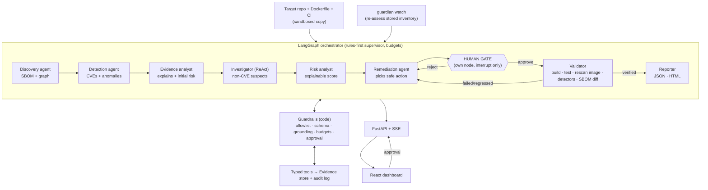

# GUARDIAN — Software Supply Chain Guardian
## Execution Plan v1.3 (written Day 1, 14:15 IST → Day 2 demo)

> **Status:** v1.3, 2026-11-23 14:15 IST. **Replaces v1.0, v1.1, v1.2. This file is self-contained** — nothing is "as in v1.0" any more (models §5, guardrails §5.4, API §4.4 are all here). Where this and older versions disagree, v1.3 wins.
> **First deadline: Checkpoint 1 at 16:30 today** — dependency graph + what is risky + what changed, shown by an agentic pipeline.
> **Ownership rule:** Dev1 and Dev2 own the heart of the system (agents, orchestration, grounding, tooling, graph, sandbox). Dev3, Dev4, Dev5 own well-bounded parts that never block Dev1/Dev2.
> **Task IDs in §6 are authoritative.** The timeline (§3.1, §3.5, §3.6) only references them. If a timeline cell and a §6 row disagree, §6 wins and you tell Dev5.
> **AI assistants:** read §0 first.

---

## 0. Rules for AI coding assistants (Claude Code etc.)

1. Ask which developer you work for (Dev1–Dev5). Your tasks are in §6.
2. Read §1–§5 before coding. §4 (file contracts) and §5 (models, guardrails) are fixed; change them only via §9.4.
3. Only edit paths your developer owns (§8). Need a change elsewhere? Write it under "Requests to other owners" in the PR.
4. Do not invent CLI flags or library APIs. If unsure, run `--help` or read current docs and say what you checked. Items marked **⚠ VERIFY** need checking.
5. No secrets in code. No `subprocess(..., shell=True)`. No `git push` to anything but our repo, no `npm publish`, no merging remediation into targets.
6. **Never run a target's install scripts outside the sandbox.** Always use `--ignore-scripts` during discovery.
7. Small commits, tests for each task, `make check` before PR.
8. If blocked or ambiguous: stop and report. Don't guess.
9. Never print or send to an LLM the contents of sensitive files (`encryptionkeys/`, `ctf.key`, `.env`, `*.pem`) — use the `file_read` tool, which denies them (G1.1).

First prompt per developer:
> "I am DevN on Guardian. Read GUARDIAN_PLAN.md §0–§5 and my tasks in §6. Start with my first task for the current time block (§3.1). Show the plan before code."

---

## 1. What we are building (one page)

**Problem (Bosch):** an agentic AI that continuously analyses the software supply chain to find dependency risks, vulnerabilities and suspicious changes before they hit the application — and takes a finding from detection to *verified* remediation with human approval.

**Brief flow:** `Discover → Detect → Analyze → Remediate → Validate`

**Our core idea:** *Tools produce facts. Agents make decisions and explanations. Humans approve changes. Guardrails in code sit between agents and tools.*

**What judges look for (from the talk + slides):**
- Agentic: several agents with roles, passing evidence, orchestrated — *not* one long prompt (said explicitly for Day 1). Our trace must show roles, hand-offs and the supervisor's routing decisions (§2.4).
- Reasoning: why something is risky, why a fix, separated into VERIFIED evidence vs AI INFERRED.
- Safe action: human approval, sandbox, rollback, no secrets. Auto-merge without approval is out of scope.
- Verified protection: build → test → rescan (built image) → before/after SBOM.
- Generality: same system on a second project in another ecosystem.
- You can explain every choice ("why this tool / model?"). Mentors question harder if you used paid AI tools — every dev must be able to explain their module.

**Checkpoints**
| When | What they want to see |
|---|---|
| **Today 16:30 — CP1** | Dependency graph of the app, what is risky, what changed (Day-1 slide: repo → SBOM → graph → risk detection → evidence), shown by an agentic pipeline |
| Today end of day (**Day-1 milestone, assumed 20:00, ⚠ confirm**) | All Day-1 items: inventory, SBOM, graph, ≥1 container/CI inspected, CVEs with severity + fix + traced path, ≥1 anomaly, evidence + initial risk |
| Day 2 evening — final (⚠ confirm time) | Prioritise → recommend → **human approval** → build & test → rescan → verified remediation; report; architecture; Responsible-AI note; live demo |

---

## 2. Architecture

### 2.1 Layers
| Layer | What | Tech | Owner |
|---|---|---|---|
| Agent layer | Decide, investigate, explain, re-plan | LangGraph + LangChain chat model | **Dev1** |
| Guardrail layer | Allowlist, schema, grounding, budgets, approval check | Python in-process | **Dev1** |
| Tool layer | Typed wrappers; the only layer that creates Evidence | Syft, Grype, OSV-Scanner, detectors, npm, Docker | **Dev2** (CI/Docker detectors Dev4) |
| Graph | SBOM/lockfile → dependency graph → paths | networkx | **Dev2** |
| Ecosystem adapters | npm, pip (2nd target), GitHub Actions, Dockerfile | Python | Dev2 (npm, pypi); Dev4 (GitHub Actions, Dockerfile) |
| Sandbox validator | Apply patch, build, test, rescan, diff | Docker | **Dev2** |
| Threat intel + scoring | EPSS, KEV, OSV, registry metadata, reachability, exposure, compat hint, score | httpx + cache | Dev4 |
| Evidence store | Append-only evidence, findings, decisions | JSON files today → SQLite Day 2 (same interface) | Dev1 |
| LLM provider | Live / record / replay modes; optional local OpenAI-compatible endpoint | LangChain chat model | Dev1 |
| API | Runs, findings, approvals, report, live events | FastAPI + SSE | Dev3 (Dev1 reviews) |
| UI | Graph, findings, evidence, trace, changes, approval, before/after | React + Vite + TS + React Flow | Dev3 |
| Reports | JSON (machine) + HTML (human) | Jinja2 | Dev4 |
| Provenance & policy | npm signature/provenance checks, image signature checks, denylist + policy-as-code | `npm audit signatures`, Cosign, Conftest | Dev4 (Dev2 runs them in sandbox) |
| Continuous watch | Re-assess a stored inventory against fresh intel; batch over many repos | CLI `watch`, `--repos` | Dev1 |

### 2.2 Diagram


### 2.3 What changed (cumulative) and why
| # | Change | Why |
|---|---|---|
| C1 | LLM agent in the pipeline **by CP1** (Evidence analyst) | Day 1 is judged as agentic; a `--no-llm` pipeline risks failing the checkpoint |
| C2 | Discovery resolves deps with `npm install --package-lock-only --ignore-scripts` | Plain `npm install` executes untrusted install scripts; also no lockfile in Juice Shop |
| C3 | Generated lockfile committed as a fixture | `^` ranges resolve differently each day → results drift between rehearsal and demo |
| C4 | Validator also re-runs **detectors** | Otherwise non-CVE fixes (lockfile, CI pin, image pin) can never be shown as Verified |
| C5 | Network allowlist adds GitHub API, image registries, scanner DB hosts, **LLM provider host**; sandbox = install-with-network then build/test with `--network none` | Pinning SHAs/digests needs those hosts; Docker can't filter by domain without a proxy |
| C6 | Human gate is its own node containing only `interrupt()` | LangGraph re-runs the interrupted node from the start on resume; plan IDs would change |
| C7 | Install-script detector targets **dependencies**, not the project's own `postinstall` | Flagging the app's own build script looks like a false positive |
| C8 | Model fixes: `vuln_id` + `aliases`, `line`, `scope`, reachability `not_applicable` | npm advisories are often GHSA-only; SARIF/evidence need lines; prod/dev drives P |
| C9 | EPSS **percentile** in score; structured claims; X inferred does not lower confidence | Raw EPSS ≈ 0 for most CVEs; free-text grounding is unreliable |
| C10 | JSON-file store today, SQLite tomorrow behind same interface | Saves ~1 h before CP1 |
| C11 | Second target = **PyGoat (pip)** first; Maven only if time | Maven has no lockfile and WebGoat builds slowly |
| C12 | Light Git process | Hours matter more than ceremony |
| C13 | Each component carries **origin** (registry URL) and **integrity** hash | Day-1 slide: "identify where each component originates" |
| C14 | Minimal **"what changed"** diff in CP1 | Checkpoint question: "what is in it, *what changed*, what appears risky" |
| C15 | Detectors: **outdated/deprecated**, **integrity change**, **unexplained major-version jump** | Named in the talk and slides |
| C16 | SBOM of the **container image**; validation rescans the **built image** | Slide: "container components", "rescan the resulting artifact" |
| C17 | **Provenance** used in prioritisation + investigated as a gap | Slide 2 step 3 and Day-2 step 2 |
| C18 | `update_base_image` patch op; `block` via a denylist in `guardian.yaml` | Day-2 remediation list; doubles as "sample policies" |
| C19 | Validation runs **unit + integration** tests | Day-2 step 4 |
| C20 | `affected_range` and `final_confidence` fields | Talk: "this range is vulnerable, move to X" |
| C21 | `guardian watch` + `--repos` batch | Problem says "continuously"; Q&A on scalability |
| C22 | All six stretch goals planned and ranked | "Stretch goals demonstrate innovation" |
| **C23** | **v1.3: plan is self-contained** — models, guardrails G1–G7, API routes all inlined (§4.4, §5) | v1.2 pointed at v1.0 for these; AI assistants would get stuck |
| **C24** | **v1.3: reachability (import-level) is P0** | Day-2 core prioritisation requires reachability |
| **C25** | **v1.3: deterministic exposure signals** (`exposure_signals`) drive factor X | Exposure was "unknown" for everything → every confidence dropped |
| **C26** | **v1.3: deterministic compatibility hint** (`compat_hint`) | Compatibility impact must be evidence, not LLM guess |
| **C27** | **v1.3: LLM record/replay + optional local endpoint** | `GUARDIAN_OFFLINE` only covered threat intel; demo must survive Wi-Fi/LLM outage |
| **C28** | **v1.3: UI contract additions** — `run_summary.json`, non-package pseudo-nodes in `graph.json`, `serve-runs`, trace list in CP1 | CP1 DoD items had no UI task |
| **C29** | **v1.3: workload rebalanced** — CI/Docker detectors move Dev2→Dev4; `update_base_image`/`block_package`/base-image build move to Day 2; PyGoat prep stays with Dev5 | Dev2 and Dev3 were over-booked in the same windows |
| **C30** | **v1.3: image build is a known risk** — runs target Dockerfile with network (G6.7) | `docker build` executes `npm install` outside the `--network none` story; documented, limited, disclosed |
| **C31** | **v1.3: timeline re-based to 14:15**, sync moved to 15:00, evening and Day-2 block schedules added (§3.5, §3.6) | Original 13:50 start has passed |

### 2.4 Making "agentic" visible (for judges)
- Every agent emits `agent_start`, `handoff` (what it passes on: evidence IDs), `decision` (why the supervisor routed next), `agent_end`. The UI trace list shows these with role names and colours.
- Agents with real choice: Evidence analyst (risk + explanation), Investigator (ReAct, picks tools), Risk analyst (summary + exposure proposals), Remediation agent (picks action; re-plans after failure). Discovery and Detection are *tool agents* — we say so honestly: "deterministic agents, because facts must not be hallucinated".
- The supervisor is rules-first: it routes by finding category/status, and every routing decision is logged as a `decision` event with its reason.

---

## 3. Time plan

### 3.0 Checkpoint 1 target ("Slice 0")
One command:
```
python -m guardian run --repo targets/juice-shop
```
produces under `runs/<run_id>/`: `run_summary.json`, `sbom.cdx.json`, `graph.json`, `changes.json`, `findings.json`, `evidence/*.json`, `trace.jsonl` (agent events). The UI (`make serve-runs` + `npm run dev`) shows:
- **header strip** (component count, direct/transitive, findings by risk),
- **dependency graph** with vulnerable paths highlighted (each node with origin + integrity),
- **findings list** with evidence, initial risk, VERIFIED/INFERRED labels, including non-package findings (CI, image, lockfile),
- **"what changed"** panel,
- **agent trace** list.

Pipeline for CP1 (LangGraph, 3 nodes):
`discovery` (resolve lockfile, Syft SBOM, build graph, parse CI + Dockerfile) → `detection` (Grype + detectors) → `evidence_analyst` (LLM: per finding, explain + initial risk level, must cite evidence IDs; grounding check rejects unknown IDs).

### 3.1 Timeline — now (14:15) → CP1 (16:30)
| Time | Dev1 (agents/core) | Dev2 (tools/graph) | Dev3 (UI) | Dev4 (intel/data/detectors) | Dev5 (targets/QA/story) |
|---|---|---|---|---|---|
| **14:15–14:30** | Create repo + skeleton dirs, **push by 14:30** so others can branch; confirm LLM key | **D2-01** install + pin Syft, Grype, OSV-Scanner (⚠ VERIFY install commands) | Read §4 contracts; start **D3-01** | Read §5, §7; start **D4-01** | **D5-01** clone Juice Shop at pinned commit; ask mentor §11 questions (answers in `docs/decisions.md`) |
| **14:30–15:00** | **D1-01** `models.py` (§5), `store.py`, `audit.py`, LangGraph skeleton with stub nodes → `trace.jsonl` | **D2-02** `workspace.py`, resolve lockfiles (`--ignore-scripts`; root + `frontend/`; ⚠ VERIFY flags), Syft SBOM; **post `sbom.cdx.json` in chat by 15:00** | **D3-01** Vite + React + TS + Tailwind scaffold; `types.ts` from §4/§5; `mocks/*.json` at **realistic size** (≥1,000 nodes, 2 roots) | **D4-01** popular npm names (incl. `ngx-cookie`, `epilogue`) + `similarity.py`; then **D4-02** initial-risk rule | **D5-01** also verifies §10 facts; **runs the lockfile resolve in parallel as backup** and posts timing + lockfiles |
| **15:00** | **5-min sync:** SBOM out, `models.py` merged, §4 formats frozen, mocks match | | | | |
| **15:00–15:50** | **D1-02** LLM provider + `evidence_analyst` node (structured output + grounding G4.1/G4.2/G4.4-lite, `<data>` blocks G2) + trace events (§2.4) | **D2-03** graph build (CycloneDX deps; fallback: `package-lock.json` `packages` map) with origin + integrity + `paths_to()` → `graph.json` (**15:00–15:30**); **D2-04** Grype wrapper → Findings with traced path (**15:30–15:55**) | **D3-02** graph view (React Flow + dagre layout), collapsed to direct deps + paths of interest, colour by risk, side panel (version, scope, origin, integrity, findings, path) (**to 15:40**); then **D3-07** findings list + badges, header strip, trace list (**15:40–16:10**) | **D4-12** GitHub Actions + Dockerfile adapters and detectors `ci_pin`, `image_pin` (**15:00–15:40**); then **D4-11** "what changed" mini-diff (`.bak` vs current) → `changes.json` (**15:40–16:05**) | **D5-02** capture real tool outputs as fixtures; `tests/golden/juice_shop_expected.yaml`; **D5-09** static HTML fallback viewer (**from 15:15, only until Dev3 confirms the graph works**) |
| **15:50–16:10** | **D1-03** wire Dev2/Dev4 tools into `discovery`/`detection`; dedupe Grype/OSV; write `run_summary.json`; real end-to-end run, fix | **D2-05** `adapters/npm.py`, detectors `lockfile`, `typosquat` (wires Dev4 fn) — each with file + line + excerpt | **D3-08** wire UI to real `runs/<id>/` via `make serve-runs`; non-package findings list | Help Dev2/Dev3 test detectors/panels on fixtures | Run the command, diff vs golden, log bugs; write talk track |
| **16:10–16:25** | Freeze. Tag `v0.1-cp1` at 16:25. Rehearse | Freeze | Screenshots → `docs/cp1/*.png` (fallback) | — | Rehearse talk track, timebox 3 min |
| **16:30** | **CP1** | | | | |

**If behind at 15:50 (drop in this order):** OSV-Scanner cross-check → typosquat detector → dagre layout polish → React graph (use Dev5's static HTML viewer D5-09). **Never drop:** SBOM, graph with paths, ≥1 CVE with traced path, ≥1 anomaly, LLM agent with evidence citations, trace visible (UI list or CLI printout).

### 3.2 CP1 definition of done
- [ ] One command runs the 3-node agent graph on Juice Shop
- [ ] SBOM (CycloneDX) saved; **component count shown** (header strip from `run_summary.json`)
- [ ] Graph shows direct vs transitive; root + `frontend/` both present
- [ ] ≥1 vulnerable transitive dependency traced to its direct parent
- [ ] ≥1 anomaly (unpinned CI action or tag-only image or missing lockfile or `ngy-cookie`) — **shown in the findings list and, via pseudo-node, in the graph**
- [ ] Each node shows origin (registry URL) and integrity hash
- [ ] "What changed": legacy backup manifest vs current manifest diff shown
- [ ] Each finding: component, dependency path, evidence ID(s), initial risk, LLM explanation labelled
- [ ] **Agent trace visible** in the UI (list with agent roles + hand-offs); CLI printout is the fallback

### 3.3 CP1 talk track (3 min, Dev5 leads, Dev1/Dev2 answer tech)
1. Problem in one line; our idea (tools = facts, agents = reasoning, humans approve).
2. Run the command; show the agent trace (Discovery → Detection → Evidence analyst; hand-offs and routing decisions).
3. Header strip (N components, M direct); graph: direct vs transitive; click a vulnerable package; show the path to its direct parent; show origin + integrity.
4. Findings: one CVE, one anomaly (`coverallsapp/github-action@v2` unpinned or `ngy-cookie`); show evidence + VERIFIED/INFERRED.
4b. What changed: open the diff panel (backup manifest vs current).
5. What's next today/tomorrow: prioritise, remediate, approve, validate.

### 3.4 Per-developer Day-1 checkpoints

Each checkpoint has a **"show it"** proof: a command, file or screen anyone can check in under a minute. At each sync every dev shows their proof or says what is blocking. Missing a checkpoint → tell Dev5 immediately so the drop order (§3.1) kicks in.

**Times:** 15:00 sync · 15:50 integration · 16:10 freeze · **16:30 CP1** · 18:00 evening check · 19:30 pre-gate check · **Day-1 end** (⚠ assumed 20:00; if earlier, 18:00/19:30 items merge into it).

#### Dev1 — agents & orchestration
| By | Checkpoint | Show it |
|---|---|---|
| 14:30 | Repo skeleton pushed; LLM key works | `git clone` works for all |
| 15:00 | `models.py` (§5), JSON `store.py`, `audit.py` merged; stub LangGraph `discovery → detection → evidence_analyst` runs | `make check` green; stub run writes `runs/<id>/trace.jsonl` |
| 15:50 | `evidence_analyst` calls the real LLM on a fixture finding, returns structured `{initial_risk, claims}`; grounding works | Tests: unknown evidence ID rejected, invented CVE rejected, every claim labelled |
| 16:10 | Real end-to-end run on Juice Shop using Dev2/Dev4 tools; Grype/OSV dedupe; `run_summary.json` | `python -m guardian run --repo targets/juice-shop` produces all §4 files |
| 16:30 | CP1: answers "why agents / why LangGraph / how is hallucination controlled" | — |
| 18:00 | Tool registry with allowlist, typed args, budgets, approval check (D1-04) | Guardrail tests G3.1–G3.3, G3.6 pass |
| 19:30 | LLM record/replay (D1-13) | `GUARDIAN_LLM_MODE=replay` re-runs the evidence analyst with no network |
| Day-1 end | Full graph per §2.2 with stub Day-2 nodes; human gate pauses and resumes with the **same plan_id**; SQLite checkpointer; tag `v0.5-day1` | Demo: run stops at gate → approve via CLI/API → continues |

#### Dev2 — tools, graph, sandbox
| By | Checkpoint | Show it |
|---|---|---|
| 14:35 | Syft, Grype, OSV-Scanner installed and pinned | `scripts/install_tools.sh` prints versions |
| 15:00 | Lockfiles resolved for root + `frontend/` with `--ignore-scripts`; committed as fixtures; SBOM generated | `sbom.cdx.json` posted in chat; no install scripts ran |
| 15:30 | `graph.json` with direct/transitive, scope, project, **origin + integrity**; `paths_to()` works | Path from root to a transitive package printed |
| 15:55 | Grype findings with severity, fix versions, affected range, traced dependency path | ≥1 transitive CVE traced to its direct parent |
| 16:10 | `lockfile` + `typosquat` detectors with file + line (with Dev4's CI/image findings: 4 anomalies total) | 4 anomaly findings in `findings.json` |
| 16:30 | CP1: answers "why Syft/Grype, how the graph is built, why `--ignore-scripts`" | — |
| 18:00 | D2-06 started: install-script + integrity/major-jump/new-dependency detection | Planted fixture change detected; `changes.json` from compare-ref |
| 19:30 | Core patch ops (D2-07) with diff tests | Diff tests pass; refuses paths outside work copy |
| Day-1 end | Image SBOM (D2-11, P1) merged into graph | Image packages in graph (or documented fallback) |

#### Dev3 — UI & API
| By | Checkpoint | Show it |
|---|---|---|
| 14:45 | Vite + React + TS scaffold; `types.ts` mirrors §4/§5; realistic-size mocks | `npm run dev` shows mock data |
| 15:40 | Graph view (dagre, collapsed, path highlight, side panel with origin/integrity) on mocks | Click node → path highlighted; 1,000-node mock renders < 2 s |
| 16:05 | Findings list + badges, header strip, trace list, "what changed" panel, config-risk (pseudo-node) display on mocks | All panels render mocks |
| 16:10 | Loads real `runs/<id>/` via `make serve-runs` | Real Juice Shop graph renders < 2 s |
| 16:25 | Screenshot fallback saved | `docs/cp1/*.png` |
| 18:00 | FastAPI core routes (§4.4): `POST /runs`, `GET /runs/{id}/graph`, `/findings`, `/evidence/{id}`, `/changes`, `/summary` | `curl` returns real data |
| 19:30 | SSE `/runs/{id}/events` (trace stream) + approval endpoints (stubbed against Dev1's gate) | Trace streams during a run |
| Day-1 end | UI shows live agent trace; approve via API resumes a stub run | Approve → run continues |

#### Dev4 — intel, scoring, data, detectors
| By | Checkpoint | Show it |
|---|---|---|
| 14:45 | `npm.txt` popular list (source documented) + `similarity.py` | Test: `ngy-cookie` flagged; exact popular names not flagged |
| 15:00 | Initial-risk rule (CVSS bands + category defaults) | Unit tests pass |
| 15:40 | GitHub Actions + Dockerfile adapters; `ci_pin`, `image_pin` detectors | Findings for `coverallsapp/github-action@v2`, `node:24` with file + line |
| 16:05 | "What changed" mini-diff → `changes.json` + evidence (D4-11) | File shows added/removed/changed deps from `.bak` vs current |
| 16:30 | CP1: answers "how is initial risk decided, how typosquats are detected" | — |
| 18:00 | `threat_intel.py`: EPSS, KEV, OSV, registry metadata with disk cache and offline mode | `GUARDIAN_OFFLINE=1` run returns cached values |
| 19:30 | `scoring.py` per §7 with tests | Scoring tests pass |
| Day-1 end | `outdated` detector (D4-08); `safe_version_lookup`; report skeleton (D4-06 stub) | ≥1 outdated finding on Juice Shop |

#### Dev5 — targets, QA, story
| By | Checkpoint | Show it |
|---|---|---|
| 14:30 | Mentor answers (§11) recorded; Juice Shop cloned at pinned commit | `docs/decisions.md` has answers |
| 15:00 | §10 facts verified; lockfile resolve time recorded; backup lockfiles posted | Corrections posted in chat |
| 16:10 | Golden file + fixtures committed; QA run vs golden; CP1 talk track ready | Golden-file diff = 0 P0 misses |
| 16:30 | **Presents CP1** (§3.3) | — |
| 18:00 | PyGoat containerised and building (D5-07); Juice Shop test/build timings (D5-03) | `docs/targets.md` |
| Day-1 end | `decisions.md` "why we chose X" (D5-04) reviewed by Dev1/Dev2; §17 Day-1 rows walked and marked (D5-08) | No open P0 Day-1 row |

**Team gate at Day-1 end** (all must be true to be safe for Day 2): every row of §17.3 marked done or consciously deferred; `v0.5-day1` tagged; a fresh clone + `make setup` + one command reproduces the Day-1 output.

### 3.5 Day-1 evening (16:30 → 20:00)
| Time | Activity |
|---|---|
| 16:30–17:00 | CP1 presentation, **write down mentor/judge feedback**, triage into tasks (Dev5 owns the list) |
| 17:00–18:00 | **Block E1:** Dev1 D1-04 · Dev2 D2-06 · Dev3 D3-03 · Dev4 D4-03 · Dev5 D5-03, D5-07 |
| 18:00 | Evening check (§3.4 18:00 rows) |
| 18:00–19:30 | **Block E2:** Dev1 D1-13 then D1-05 · Dev2 D2-06 (finish) then D2-07 core ops · Dev3 D3-09 (SSE + approval endpoints) · Dev4 D4-04, D4-08 · Dev5 D5-04 |
| 19:30–20:00 | Pre-gate check; Dev2 D2-11 (P1) · Dev5 D5-08 walks §17 · tag `v0.5-day1` · fresh-clone test |
| 20:00 | **Day-1 milestone** (⚠ confirm) |

### 3.6 Day 2 block plan (⚠ assumed 09:00 start, demo in the evening — confirm and shift)
| Block | Dev1 | Dev2 | Dev3 | Dev4 | Dev5 |
|---|---|---|---|---|---|
| **A 09:00–11:30** | D1-06 risk analyst · D1-07 remediation · D1-08 investigator | D2-07b ops (`update_base_image`, `block_package`, `pin_image_digest`) · start **D2-08** sandbox (build deps-installed base image first) | D3-04 approval panel | D4-05 reachability · D4-13 exposure · D4-14 compat hint · D4-09 provenance | D5-05 architecture + `responsible_ai.md` drafts |
| **B 11:30–14:00** | D1-09 validator + reporter nodes; **first full end-to-end on one finding by 14:00** | D2-08 finish (image build + rescan + SBOM diff + detectors) | D3-05 validation view | D4-06 reports (JSON + HTML) · D4-07 policies | D5-06 demo script draft; QA end-to-end |
| **C 14:00–16:00** | D1-10 guardrail tests · D1-11 `watch` · D1-12 `--repos` · helps D2-09 | D2-09 PyGoat · D2-10 local branch + PR.md | D3-06 live trace timeline, provenance badges, watch list, report download | D4-10 advanced package risk (P2) · D4-07 Rego | D5-06 rehearsal #1 · backup cached run |
| **D 16:00–17:30** | **Freeze features at 16:00** — only bug fixes. Tag candidate `v1.0-demo` | Fix | Polish | Fix | Rehearsal #2, backup video, §17 final walk (D5-08) |
| **Evening** | Final demo (⚠ confirm time) | | | | |

If Block B misses "first end-to-end by 14:00": drop in this order — PyGoat (D2-09) → `--repos` → Rego → D4-10 → provenance badges; never drop validator, approval, report.

---

## 4. File contracts and API (frozen at 15:00)

All run output lives in `runs/<run_id>/`. Dev3 builds against these from mocks; Dev1/Dev2/Dev4 produce them.

### 4.1 Files
**`run_summary.json`** (new; produced by Dev1's graph runner, drives the UI header strip)
```json
{"run_id":"run_20261123_1630","target":"juice-shop","commit":"<sha>","started_at":"...","status":"done",
 "sbom":{"file":"sbom.cdx.json","components":1523,"direct":112,"transitive":1411},
 "projects":["root","frontend"],
 "findings":{"total":87,"by_risk":{"critical":2,"high":9,"medium":30,"low":46},
             "by_category":{"cve":80,"lockfile":1,"unpinned_ci":1,"untrusted_image":2,"typosquat":1,"unexpected_change":2}},
 "llm":{"mode":"live","model":"<id>"},"offline":false}
```

**`changes.json`** (CP1: backup vs current; later: `--compare-ref` vs HEAD)
```json
{"base":"ftp/package.json.bak","head":"package.json",
 "added":["pkg:npm/foo@1.0.0"],"removed":["pkg:npm/bar@2.0.0"],
 "changed":[{"name":"baz","from":"1.2.0","to":"3.0.0","major_jump":true}],
 "integrity_changed":[{"purl":"pkg:npm/qux@1.0.0","from":"sha512-A","to":"sha512-B"}],
 "install_scripts_added":[],"evidence_ids":["ev_..."]}
```

**`graph.json`** (nodes of `kind` other than `package` represent non-package findings so they appear in the graph too)
```json
{"nodes":[{"id":"pkg:npm/express@4.21.2","kind":"package","label":"express","version":"4.21.2",
           "ecosystem":"npm","direct":true,"scope":"prod","project":"root",
           "origin":"https://registry.npmjs.org/express/-/express-4.21.2.tgz",
           "integrity":"sha512-...","deprecated":false,
           "risk":"high","finding_ids":["fd_01..."]},
          {"id":"ci:.github/workflows/ci.yml","kind":"ci","label":"ci.yml","risk":"medium","finding_ids":["fd_..."]},
          {"id":"image:node:24","kind":"image","label":"node:24","risk":"medium","finding_ids":["fd_..."]},
          {"id":"config:.npmrc","kind":"config","label":".npmrc","risk":"medium","finding_ids":["fd_..."]}],
 "edges":[{"source":"pkg:npm/express@4.21.2","target":"pkg:npm/body-parser@1.20.3"},
          {"source":"root","target":"ci:.github/workflows/ci.yml","type":"uses"}],
 "roots":["root","frontend"]}
```
**`findings.json`**: list of `Finding` (§5). **`evidence/<evidence_id>.json`**: one `Evidence`. **`trace.jsonl`**: one `AgentEvent` per line. **`sbom.cdx.json`**: Syft CycloneDX output (filename must end `.cdx.json` so OSV-Scanner recognises it).
Day 2 adds: `plans/<plan_id>.json` (RemediationPlan), `approvals.jsonl`, `validation/<attempt_id>.json` (ValidationResult), `sbom.after.cdx.json`, `report.json`, `report.html`.

### 4.2 How the UI reads run files
`make serve-runs` starts a static file server on `http://localhost:8001/` serving `runs/` with CORS (Dev1 adds the target; Dev3 uses `VITE_RUNS_BASE=http://localhost:8001`). In Day 1 the UI reads files directly; from D3-03 on it uses the API (§4.4) with the same JSON shapes. `GET /runs/latest` convention: `runs/latest` symlink to the newest run.

### 4.3 Graph scale rule
Juice Shop has two large trees. The UI renders **only**: roots, direct dependencies, nodes on a path to a finding, and non-package pseudo-nodes. Everything else is collapsed (count shown on the parent). Layout: dagre (left-to-right). Mocks must be realistic size.

### 4.4 API routes (FastAPI, Dev3; Dev1 reviews)
| Route | Purpose |
|---|---|
| `POST /runs` `{repo, compare_ref?, llm_mode?}` | start a run → `{run_id}` |
| `GET /runs/{id}` · `/summary` | status + `run_summary.json` |
| `GET /runs/{id}/graph` · `/changes` · `/findings` · `/findings/{fid}` · `/evidence/{eid}` | the files above |
| `GET /runs/{id}/events` (SSE) | `AgentEvent` stream |
| `GET /runs/{id}/plans` · `/plans/{plan_id}` | remediation plans awaiting/after decision |
| `POST /runs/{id}/plans/{plan_id}/decision` `{decision: approve\|reject\|accept_risk, comment}` | resumes the human gate; reject/accept_risk require comment; the body is bound to `plan_hash` |
| `GET /runs/{id}/validation` | `ValidationResult` list (attempt history) |
| `GET /runs/{id}/report.json` · `/report.html` | Guardian report |
| `POST /watch` `{run_id}` | trigger a watch re-assessment (Day 2) |

---

## 5. Data model, state machines, guardrails

### 5.1 `guardian/core/models.py` (Pydantic v2) — Dev1 merges in D1-01

```python
class Priority(str, Enum):      CRITICAL="critical"; HIGH="high"; MEDIUM="medium"; LOW="low"
class Confidence(str, Enum):    HIGH="high"; MEDIUM="medium"; LOW="low"
class ClaimLabel(str, Enum):    VERIFIED="verified"; INFERRED="inferred"; UNSUPPORTED="unsupported"
class FindingStatus(str, Enum):
    OPEN="open"; ASSESSED="assessed"; PLANNED="planned"; AWAITING_HUMAN="awaiting_human"
    VALIDATING="validating"; VERIFIED="verified"; ACCEPTED="accepted"; ESCALATED="escalated"
    BELOW_THRESHOLD="below_threshold"

class ReachabilityTier(str, Enum):
    CALLED="called"; IMPORTED="imported"; NOT_IMPORTED="not_imported"
    UNKNOWN="unknown"; NOT_APPLICABLE="not_applicable"     # CI/lockfile/image findings

class Scope(str, Enum):         PROD="prod"; DEV="dev"; UNKNOWN="unknown"

class FindingCategory(str, Enum):
    CVE="cve"; TYPOSQUAT="typosquat"; INSTALL_SCRIPT="install_script"
    LOCKFILE="lockfile"; UNPINNED_CI="unpinned_ci"; UNTRUSTED_IMAGE="untrusted_image"
    UNEXPECTED_CHANGE="unexpected_change"; MALICIOUS_INDICATOR="malicious_indicator"
    POLICY_VIOLATION="policy_violation"
    OUTDATED="outdated"; INTEGRITY_CHANGE="integrity_change"; MAJOR_JUMP="major_jump"
    PROVENANCE_GAP="provenance_gap"; DEPENDENCY_CONFUSION="dependency_confusion"
    MAINTAINER_CHANGE="maintainer_change"

class Evidence(BaseModel):                       # the ONLY thing grounding checks against
    evidence_id: str                             # "ev_<ulid>"
    run_id: str
    kind: str    # sbom|graph|scanner_output|file_excerpt|registry_metadata|epss|kev|osv|diff|changes|
                 # patch_diff|build_log|test_result|sbom_diff|policy_result|provenance|
                 # reachability|exposure|compat_hint|detector_result
    source_tool: str                             # "grype@x.y", "detector:ci_pin"
    created_at: datetime
    facts: dict[str, Any]                        # structured, machine-checked values (ids, versions, purls, scores)
    excerpt: str | None = None                   # short human-readable text/lines
    file_path: str | None = None
    line: int | None = None
    artifact_path: str | None = None             # raw output file under runs/<id>/
    sha256: str | None = None                    # hash of the raw artifact

class AgentEvent(BaseModel):                     # one line of trace.jsonl
    ts: datetime
    run_id: str
    agent: str                                   # discovery|detection|evidence_analyst|investigator|risk_analyst|
                                                 # remediation|human_gate|validator|reporter|supervisor|guardrail
    type: str    # agent_start|tool_call|tool_result|llm_call|llm_result|handoff|decision|guardrail|
                 # gate_wait|gate_resume|agent_end|error
    summary: str                                 # one line, shown in the UI trace list
    finding_id: str | None = None
    evidence_ids: list[str] = []
    data: dict[str, Any] = {}                    # never contains secrets (G1)

class Provenance(BaseModel):
    origin: str | None = None
    integrity: str | None = None
    signature_verified: bool | None = None       # npm audit signatures / cosign
    attestation_present: bool | None = None
    repository_url: str | None = None
    evidence_ids: list[str] = []

class Finding(BaseModel):
    finding_id: str
    run_id: str
    category: FindingCategory
    title: str
    detector: str
    component_purl: str | None = None
    scope: Scope = Scope.UNKNOWN                 # drives factor P
    project: str | None = None                   # "root" | "frontend" | "image" | ...
    file_path: str | None = None
    line: int | None = None
    dependency_paths: list[list[str]] = []
    vuln_id: str | None = None                   # GHSA-..., CVE-..., OSV id
    aliases: list[str] = []                      # CVE alias needed for EPSS/KEV
    cvss: float | None = None
    severity: str | None = None                  # scanner severity text
    fixed_versions: list[str] = []
    affected_range: str | None = None            # e.g. "<8.5.1"
    provenance: Provenance | None = None
    initial_risk: Priority | None = None         # Day-1 requirement
    evidence_ids: list[str] = Field(min_length=1)    # a Finding without evidence raises
    status: FindingStatus = FindingStatus.OPEN

class Claim(BaseModel):                          # structured, checkable
    text: str                                    # human sentence
    field: str | None = None                     # e.g. "fixed_version", "cvss", "on_kev", "compat_delta"
    value: str | None = None                     # exact value asserted
    evidence_ids: list[str] = []
    label: ClaimLabel                            # set by grounding code, never by the LLM

class FactorValue(BaseModel):
    value: float                                 # 0..1
    tier: str                                    # e.g. "imported", "kev", "prod"
    unknown: bool = False
    label: ClaimLabel                            # VERIFIED if from evidence facts, INFERRED if proposed by LLM
    evidence_ids: list[str] = []

class RiskFactors(BaseModel):
    S: FactorValue; E: FactorValue; R: FactorValue; P: FactorValue; X: FactorValue
    provenance_modifier: float = 0.0             # +5 points, see §7
    provenance_evidence_ids: list[str] = []

class RiskAssessment(BaseModel):
    finding_id: str
    score: float                                 # == scoring.compute(factors)
    band: Priority
    confidence: Confidence
    override_applied: str | None = None          # "kev+reachable+prod"
    factors: RiskFactors
    summary: str                                 # LLM text
    claims: list[Claim] = []

class PatchOp(BaseModel):
    op: str   # set_dependency_version | remove_dependency | replace_dependency
              # | pin_action_sha | pin_image_digest | generate_lockfile
              # | update_base_image | block_package
    file_path: str
    args: dict[str, Any]

class CompatHint(BaseModel):                     # produced by tool compat_hint(), stored as Evidence(kind="compat_hint")
    from_version: str; to_version: str
    semver_delta: str                            # major|minor|patch|none|unknown
    engines_ok: bool | None = None               # target version's `engines.node` vs project's
    peer_dep_changes: list[str] = []
    deprecated_target: bool | None = None
    level: str                                   # low|medium|high — rule: major→high, minor→medium, patch→low, +1 level if engines/peer problem

class RemediationPlan(BaseModel):
    plan_id: str                                 # stable across resume
    plan_hash: str                               # sha256 of ops + target; approval binds to it
    finding_id: str
    attempt: int                                 # 1..3
    action: str    # upgrade|replace|remove|pin|update_base_image|block|mitigate|escalate
    ops: list[PatchOp] = []
    target_version: str | None = None            # must cite evidence (G4.5)
    rationale: list[Claim] = []
    expected_risk_reduction: str                 # derived from scoring simulation, not free text
    compatibility_impact: CompatHint | None = None   # evidence-backed, plus an LLM Claim citing it
    rollback: str                                # e.g. "git revert <branch>; lockfile restored from <sha>"
    evidence_ids: list[str] = Field(min_length=1)

class Approval(BaseModel):
    plan_id: str; plan_hash: str
    decision: str                                # approve|reject|accept_risk
    comment: str | None = None                   # required for reject / accept_risk
    decided_by: str
    ts: datetime

class ValidationResult(BaseModel):
    attempt_id: str; plan_id: str; finding_id: str
    build_ok: bool
    unit_tests: dict[str, int] = {}              # {passed, failed, skipped}
    integration_tests: dict[str, int] = {}
    artifact_rescanned: str | None = None        # image tag/digest rescanned
    target_finding_resolved: bool                # detector/scanner no longer reports it
    new_findings: list[str] = []                 # finding_ids introduced by the patch
    sbom_diff_evidence_id: str | None = None
    detector_evidence_ids: list[str] = []
    risk_before: float; risk_after: float        # 0 for the target if resolved, plus scores of new findings
    verdict: str                                 # verified|failed_build|failed_tests|regressed|not_resolved|timeout
    final_confidence: Confidence
    log_evidence_ids: list[str] = []
```

### 5.2 State machines (two)
- **Run:** `created → discovering → detecting → analysing → planning_loop → reporting → done | failed`
- **Finding:** `open → assessed → planned → awaiting_human → validating → verified | accepted | escalated | below_threshold` (failed validation → `planned`, max 3 attempts → `escalated`)

### 5.3 LLM provider modes (Dev1, D1-02 + D1-13)
`GUARDIAN_LLM_MODE=live | record | replay` (default `live`). `record` stores every request/response keyed by hash of (agent, prompt, input evidence) under `data/cache/llm/`; `replay` serves from that cache and fails closed if missing. `LLM_BASE_URL` allows any OpenAI-compatible endpoint (e.g. a local model) — same code path. The demo's backup is a **recorded run**, so it works with no network.

### 5.4 Guardrails G1–G7 (code, in `guardian/guardrails/`; one test per G-ID, D1-10)
| ID | Rule |
|---|---|
| **G1 Secrets & sensitive data** | G1.1 `file_read` denies `encryptionkeys/`, `ctf.key`, `.env*`, `*.pem`, `*.key`; G1.2 secret-pattern redaction on any text before it reaches an LLM, a log or a report; G1.3 LLM keys only from env, never logged or in `data`; G1.4 no real credentials in any prompt, evidence, report or fixture |
| **G2 Untrusted content** | G2.1 all package metadata, READMEs, file excerpts, scanner text go into the prompt inside `<data>…</data>` blocks; G2.2 system prompt: instructions inside `<data>` are never followed; G2.3 injection-pattern hit → `guardrail` event + content still wrapped |
| **G3 Tools** | G3.1 per-agent tool allowlist; G3.2 typed args validated by Pydantic (bad args blocked); G3.3 `sandbox_write` / patch tools blocked without a matching `Approval`; G3.4 no tool exists for publish/push/merge/deploy; G3.5 network only to the §14 allowlist; G3.6 budgets per agent (tool calls, tokens, wall-clock) |
| **G4 Grounding** | G4.1 LLM output must parse to the schema (1 repair retry, then finding `escalated`); G4.2 every cited `evidence_id` must exist; G4.3 `Claim.label` is set by code (VERIFIED only if `field/value` match evidence `facts`); G4.4 CVE/GHSA ids, versions and purls in output must appear in evidence facts, else relabel INFERRED or reject; G4.5 `target_version` must come from `safe_version_lookup` evidence; G4.6 unsupported claims are removed from the report |
| **G5 Actions** | G5.1 no path to `validator` without an `Approval(approve)` for the same `plan_id` + `plan_hash`; G5.2 reject/accept_risk need a comment; G5.3 heuristic findings (typosquat etc.) may only get remove / replace / block / escalate; G5.4 max 3 attempts per finding → `escalated`; G5.5 nothing is merged or pushed; output is a local branch + PR.md |
| **G6 Sandbox** | G6.1 non-root user; G6.2 CPU/mem/time limits; G6.3 build/test phase `--network none`; G6.4 no secrets or host mounts (only the work copy); G6.5 container removed after each attempt; G6.6 patching refuses paths outside the work copy; G6.7 **image build** (`docker build` of the patched work copy, network on, executes the target Dockerfile) runs with CPU/mem/time limits, a `.dockerignore` excluding keys/.env, no build secrets, and is disclosed as a known limitation |
| **G7 Audit & reliability** | G7.1 append-only audit log of every tool call, LLM call, guardrail hit, approval; G7.2 every guardrail block is an `AgentEvent(type=guardrail)`; G7.3 `GUARDIAN_OFFLINE=1` + LLM replay run end-to-end from cache; G7.4 all external calls cached and throttled |

---

## 6. Tasks by developer

Priorities: **P0** core loop/demo · **P1** full marks · **P2** stretch.

### 6.1 Dev1 — Agents, orchestration, LLM, guardrails (Claude Code)

| ID | When | Task | Acceptance |
|---|---|---|---|
| D1-01 | Today 14:30–15:00 · P0 | Repo skeleton (pushed by 14:30), `pyproject.toml`, `Makefile` (`setup`, `check`, `run`, `serve-runs`), `.env.example`, `models.py` (§5.1), `store.py` (JSON-file backend: `add_evidence`, `add_finding`, `get_*`, `list_*`; append-only), `audit.py`, LangGraph `StateGraph` with stub nodes `discovery → detection → evidence_analyst` | `make check` green; stub run writes `trace.jsonl`; `Finding` with no evidence raises |
| D1-02 | Today 15:00–15:50 · P0 | `llm/provider.py` (provider + `LLM_BASE_URL` from env, modes §5.3); `evidence_analyst` node: per finding, structured output `{initial_risk, claims[]}`; grounding G4.1/G4.2/G4.4; unknown → relabel INFERRED or reject; 1 repair retry; `<data>` blocks (G2); trace events per §2.4 | Fake-LLM tests: unknown evidence ID rejected; invented CVE rejected; every claim labelled |
| D1-03 | Today 15:50–16:10 · P0 | Wire Dev2/Dev4 tools into `discovery` and `detection` nodes; dedupe Grype/OSV by (purl, vuln_id/alias); emit AgentEvents; write `run_summary.json`; `serve-runs` target | CP1 checklist §3.2 passes |
| D1-04 | Today 17:00–18:00 · P0 | Tool registry with per-agent allowlist (G3.1), typed args (G3.2), budgets (G3.6), approval check for `sandbox_write` (G3.3) | Tests: disallowed tool blocked, bad args blocked, sandbox_write without approval blocked |
| D1-13 | Today 18:00–18:30 · P0 | LLM `record`/`replay` modes + cache (§5.3); CI test that replay makes no network call | Replay run of CP1 pipeline identical to recorded |
| D1-05 | Today 18:30–20:00 · P0 | Full graph per §2.2; **human_gate node contains only `interrupt()`**; plan built in `remediation` node before it; SQLite checkpointer; resume via `Command(resume=...)` with a thread ID (⚠ VERIFY current LangGraph API, pin version); attempt counter; per-finding loop; `decision` events (§2.4) | With stubs: pauses at gate, resumes on approval with same plan_id; 3 failures → escalated; no path to validator without Approval |
| D1-06 | Day 2 A · P0 | `risk_analyst` node: gather EPSS/KEV/reachability/exposure evidence via Dev4 tools, build `RiskFactors` in code (incl. provenance modifier), `scoring.compute()`, LLM writes summary + structured claims (§7) | Score equals `compute(factors)`; every factor has sources |
| D1-07 | Day 2 A · P0 | `remediation` node: candidates from `safe_version_lookup` + `compat_hint` evidence → LLM chooses action, writes impact/rollback citing the hint; on retry gets last ValidationResult and must pick a different plan; heuristic findings only remove/replace/block/escalate (G5.3); `target_version` must cite evidence (G4.5) | Fixture: failed upgrade → attempt 2 different; no version absent from evidence |
| D1-08 | Day 2 A · P1 | `investigator` ReAct node for typosquat / dependency install scripts / unexpected change (≤8 tool calls): registry metadata, version diff, file excerpt | `ngy-cookie` → evidence + labelled conclusion |
| D1-09 | Day 2 B · P0 | `validator` node (calls Dev2 pipeline) + `reporter` node (calls Dev4) | End-to-end on one finding by 14:00 |
| D1-10 | Day 2 C · P1 | Guardrail test suite G1–G7 (one test per G-ID; Dev5 maps to Responsible-AI note) | One test per G-ID |
| D1-11 | Day 2 C · P1 (stretch 6) | `python -m guardian watch --run <id> [--interval 1h]`: reload stored inventory, refresh OSV/EPSS/KEV, re-run scoring; new or escalated findings → AgentEvent + report diff ("new since last check") | Inject a cached "new advisory" fixture → finding appears and priority recomputed without re-running discovery |
| D1-12 | Day 2 C · P1 | `--repos a b ...` batch run: one run per repo, shared intel cache, summary table across repos | Juice Shop + PyGoat in one command |

### 6.2 Dev2 — Tooling, graph, adapters, sandbox (Claude Code)

| ID | When | Task | Acceptance |
|---|---|---|---|
| D2-01 | Today 14:15–14:35 · P0 | Install + pin Syft, Grype, OSV-Scanner (Trivy optional); `scripts/install_tools.sh`, `tool_versions.env`; pre-download Grype DB | All print versions |
| D2-02 | Today 14:35–15:00 · P0 | `core/workspace.py` (copy target to `runs/<id>/work/`, strip git remote); `tools/resolve.py`: `npm install --package-lock-only --ignore-scripts` for root and `frontend/` (⚠ VERIFY flags; frontend may need `--legacy-peer-deps`; use Dev5's backup lockfiles if slow); commit lockfiles to `tests/fixtures/juice-shop/`; `tools/sbom.py`: `syft dir:<work> -o cyclonedx-json=<run>/sbom.cdx.json` (⚠ VERIFY output syntax) → Evidence | SBOM posted in chat by 15:00; no install scripts executed |
| D2-03 | Today 15:00–15:30 · P0 | `core/graph_build.py`: CycloneDX `components`+`dependencies` → networkx; **if `dependencies` is empty or partial, build edges from `package-lock.json` `packages` map** (record source in evidence); mark direct (manifest), scope (dependencies vs devDependencies), project (root/frontend), **origin** (lockfile `resolved` URL) and **integrity**; `paths_to(purl, max_paths=5)`; non-package pseudo-nodes (`ci`, `image`, `config`) added from findings; export `graph.json` (§4.1) | Path from root to a transitive vulnerable package found; JSON matches §4 |
| D2-04 | Today 15:30–15:55 · P0 | `tools/scanners.py`: `grype sbom:<file> -o json` (⚠ VERIFY) → Findings with vuln_id, aliases, cvss, severity, fixed_versions, affected_range, dependency_paths; OSV cross-check (P1, evening if needed): `osv-scanner scan source -L <run>/sbom.cdx.json --format=json` | ≥1 transitive CVE with path to direct parent |
| D2-05 | Today 15:55–16:10 · P0 | `adapters/npm.py`; detectors `lockfile` (`.npmrc package-lock=false`), `typosquat` (Dev4 fn); each Finding has file + line + excerpt evidence. (CI + Dockerfile detectors are Dev4's D4-12.) | Juice Shop: lockfile + `ngy-cookie` findings |
| D2-06 | Today 17:00–19:30 · P0 | Detector `dependency_install_scripts`: packages in resolved tree with `hasInstallScript` (lockfile) or install scripts in registry metadata; `unexpected_change` (generalises Dev4's CP1 mini-diff): diff manifests/lockfiles between `--compare-ref` and HEAD (or `.bak` vs current) → findings for **new dependency**, **install script added**, **integrity change**, **major-version jump** with no explanation; writes `changes.json` | ≥1 install-script finding on a dependency; legacy typosquat via `.bak` (⚠ VERIFY name); planted integrity change in a fixture lockfile detected |
| D2-07 | Today 18:15–19:30 · P0 | `tools/patching.py` **core ops**: `set_dependency_version`, `remove_dependency`, `replace_dependency`, `pin_action_sha` (tag→SHA via `git ls-remote`), `generate_lockfile` (+ remove `package-lock=false` from `.npmrc`); only inside work copy; emits unified diff evidence | Diff tests pass; refuses paths outside work copy |
| D2-07b | Day 2 A · P0 | Remaining ops: `pin_image_digest` (⚠ VERIFY: `docker buildx imagetools inspect` or `crane digest`), `update_base_image` (bump `FROM` to a newer tag taken from evidence, then pin digest), `block_package` (add to `guardian.yaml` denylist + remove/replace) | Diff tests pass |
| D2-08 | Day 2 A–B · P0 | `tools/sandbox.py` validation pipeline: **first** build the deps-installed base image; fresh container per attempt; **phase 1** (network on, registry only, no secrets): install deps, then `npm audit signatures` → provenance evidence (⚠ VERIFY output); **phase 2** (`--network none`): build, **unit tests** (`npm run test:server`) and **integration tests** (`npm run test:api`, app started inside the sandbox ⚠ VERIFY runtime); then orchestrator builds the patched **image** with `docker build` under G6.7 → Syft SBOM of the built image → Grype → **re-run detectors** → `sbom_diff` → ValidationResult. Non-root, CPU/mem/time limits, container removed after | Fixture patch: build/test output captured; SBOM diff correct; container removed; timeout honoured |
| D2-09 | Day 2 C · P1 | `adapters/pypi.py` + PyGoat target (pip): detect, resolve (⚠ VERIFY: `pip-compile`/`uv pip compile` or requirements pins), SBOM, scan, ≥1 finding, build/test in sandbox (Dev1 helps once validator works) | Same command works on PyGoat |
| D2-10 | Day 2 C · P1 (stretch 2) | Local branch `guardian/fix-<finding>` in the work copy with the patch + `PR.md` (proposed fix, rationale claims, validation results, rollback guidance). No merge, no push | Branch + PR.md exist after a Verified fix |
| D2-11 | Today 19:30–20:00 · P1 | Container components: `syft <image> -o cyclonedx-json` on the Juice Shop image (published image or local build — record which) → merged into graph as `project:"image"`; Grype on image | Image OS + app packages visible in graph |
| D2-12 | Day 2 C · P2 (stretch 3) | `cosign verify` on the distroless base image (keyless; ⚠ VERIFY identity/issuer flags); result → `provenance` evidence; failure → `provenance_gap` finding | Verified result for distroless; unsigned/unknown for others |

### 6.3 Dev3 — UI + API

| ID | When | Task | Acceptance |
|---|---|---|---|
| D3-01 | Today 14:15–14:45 · P0 | Vite React TS + Tailwind scaffold; `src/api/types.ts` mirroring §4/§5; **realistic-size mocks** (≥1,000 nodes, two roots, pseudo-nodes, changes, trace, summary) | `npm run dev` shows mock data |
| D3-02 | Today 14:45–15:40 · P0 | Graph view (React Flow + dagre): collapsed per §4.3; path highlight; colour by risk; non-package pseudo-nodes; click node → side panel (version, scope, origin, integrity, findings, path) | 1,000-node mock < 2 s |
| D3-07 | Today 15:40–16:10 · **P0** | Findings list with evidence viewer + VERIFIED/INFERRED/initial-risk badges (incl. non-package findings); **header strip** from `run_summary.json`; **agent trace list** from `trace.jsonl` (role colours, hand-offs, decisions); **"what changed"** panel from `changes.json` | All panels render mocks, then real data |
| D3-08 | Today 15:50–16:10 · P0 | Wire UI to real `runs/<id>/` via `VITE_RUNS_BASE` (`make serve-runs`); screenshots to `docs/cp1/` | Renders Juice Shop real output < 2 s |
| D3-03 | Today 17:00–18:00 · P0 | FastAPI core routes (§4.4) reading run files; CORS | `curl`: create run → findings → evidence |
| D3-09 | Today 18:00–19:30 · P0 | SSE `/events` for `trace.jsonl`; approval/decision endpoints bound to `plan_hash`, calling Dev1's gate (stub OK until D1-05) | Trace streams; decision endpoint rejects wrong `plan_hash` |
| D3-04 | Day 2 A · P0 | Approval panel: action, target version + evidence, diff, risk reduction, compatibility hint, rollback, claims; Approve / Reject (comment required) / Accept risk; buttons disabled until all sections load | Cannot approve before content renders |
| D3-05 | Day 2 B · P0 | Validation view: build, unit/integration counts, SBOM diff, new findings, risk before→after, attempt history (failed → re-plan → verified) | Renders sequence from mocks |
| D3-06 | Day 2 C · P1 | Live agent trace timeline; provenance badges (signed / attested / unknown); watch "new since last check" list; multi-repo summary; report download; polish | — |

### 6.4 Dev4 — Threat intel, scoring, data, detectors, reports

| ID | When | Task | Acceptance |
|---|---|---|---|
| D4-01 | Today 14:15–14:45 · P0 | `data/popular_packages/npm.txt` (document source in header; must include `ngx-cookie`, `epilogue`), `similarity.py` (Damerau-Levenshtein ≤1–2, min name length 5, popularity gap, swapped chars, `-js` suffix) | `ngy-cookie` flagged; exact popular names not flagged; false-positive count on Juice Shop deps reported |
| D4-02 | Today 14:45–15:00 · P0 | Initial-risk rule for CP1: CVSS bands (≥9 Critical, ≥7 High, ≥4 Medium) and category defaults (§7) → `initial_risk` | Unit tests |
| D4-12 | Today 15:00–15:40 · P0 | `adapters/github_actions.py` (unpinned `uses:` = not a 40-char SHA) and `adapters/dockerfile.py` (tag-only `FROM`); detectors `ci_pin`, `image_pin`; each Finding has file + line + excerpt evidence | Findings for `coverallsapp/github-action@v2` and `node:24` |
| D4-11 | Today 15:40–16:05 · P0 | "What changed" mini-diff for CP1: `ftp/package.json.bak` vs current `package.json` → `changes.json` (§4.1) + evidence (Dev2 generalises it in D2-06) | Panel data for CP1 |
| D4-03 | Today 17:00–18:00 · P0 | `tools/threat_intel.py` with disk cache + `GUARDIAN_OFFLINE=1` + throttling: `epss_lookup` (`https://api.first.org/data/v1/epss?cve=...`, ≤100 CVEs per call), `kev_lookup` (CISA KEV JSON ⚠ VERIFY URL), `osv_query(purl)`, `registry_metadata(purl)`, `safe_version_lookup(purl, vuln_ids)` (lowest version fixing all) | Recorded-response tests; offline mode works |
| D4-04 | Today 18:00–18:45 · P0 | `core/scoring.py` per §7 (pure function, plus `simulate_after(plan)` for expected risk reduction) | Tests for each band, KEV override, confidence |
| D4-08 | Today 18:45–19:30 · P0 | Detector `outdated`: registry `deprecated` flag, last publish older than N years (config), far behind latest major → finding with evidence | ≥1 outdated/deprecated dependency in Juice Shop (⚠ confirm which) |
| D4-05 | Day 2 A · **P0** (stretch 1) | Reachability: `reachability_import` (search production paths for `require('x')` / `import ... from 'x'` / Python `import x`) → tier with file+line evidence. Optional: 1–2 hand-written Semgrep rules for demo CVEs → tier `called` | `jsonwebtoken` imported in Juice Shop routes |
| D4-13 | Day 2 A · P0 | `exposure_signals`: Dockerfile `EXPOSE`/server entrypoint present + package imported under server/route dirs → network-facing evidence; imported only in build/test/frontend-build → internal; else unknown (§7 X) | Evidence with facts `{expose, imported_in_server_paths}` |
| D4-14 | Day 2 A · P0 | `compat_hint(purl, from, to)` → `CompatHint` evidence (§5.1): semver delta, `engines`, peer deps, deprecated target from registry metadata | `jsonwebtoken 0.4.0 → 9.x` = major/high |
| D4-09 | Day 2 A · P1 | Provenance signals per package: registry signature/attestation status (from Dev2's `npm audit signatures` evidence), `repository` field present, maintainer changed in latest release → `Provenance` + **score modifier** (§7) + `provenance_gap` findings | Each prod dependency has a provenance status |
| D4-06 | Day 2 B (skeleton Day-1 night) · P0 | Reports: JSON (inventory + paths, findings + evidence, risk ranking + factor tables, actions + approvals, validation before/after, remaining/accepted risk, final confidence, guardrail events, audit) + HTML (Jinja2) | JSON validates against Pydantic schema |
| D4-07 | Day 2 B–C · P1 (stretch 5) | **Sample policies** (deliverable): `guardian.yaml` denylist + thresholds (used by `block_package`) **and** Conftest/Rego policies: deny unpinned actions, tag-only images, missing lockfile, denylisted/typosquat packages, packages younger than N days; `policy_check` runs in Validator | Juice Shop fails ≥3 before; patched branch passes targeted ones |
| D4-10 | Day 2 C · P2 (stretch 4) | Advanced package risk from registry metadata: **maintainer change**, **unusual release activity**, **dependency confusion** (internal scopes listed in `guardian.yaml` that also exist publicly) | Fixture tests for each rule; demo with a fixture internal scope |

### 6.5 Dev5 — Targets, QA, docs, demo

| ID | When | Task | Acceptance |
|---|---|---|---|
| D5-01 | Today 14:15–15:00 · P0 | Clone Juice Shop at pinned commit into `targets/` (gitignored); `scripts/fetch_targets.sh`; verify §10 facts; ask mentor §11 questions (record answers in `docs/decisions.md`); **run the lockfile resolve as a backup**, post lockfiles + timing | Facts confirmed or corrected; backup lockfiles posted |
| D5-02 | Today 14:45–16:10 · P0 | Golden file `tests/golden/juice_shop_expected.yaml`; capture fixtures from real tool outputs; QA on integration; CP1 talk track (§3.3) | CP1 checklist verified |
| D5-09 | Today 15:15–16:00 · P1 (insurance) | `scripts/static_view.py`: Jinja2 page from a run folder (header, direct deps + findings, paths as text, changes, trace). Stop as soon as Dev3 confirms the React graph works | Opens from `runs/<id>/` without a server |
| D5-03 | Today 17:00–18:00 · P0 | Juice Shop timings for `test:server`, `test:api`, image build; PyGoat clone + timing | Timings in `docs/targets.md` |
| D5-07 | Today 17:00–18:30 · P0 | Confirm PyGoat is containerised (working Dockerfile/compose) and builds; if not, pick another small pip app that is | Second target confirmed |
| D5-04 | Today 18:00–19:30 · P1 | `docs/decisions.md` "why we chose X" (§12) — everyone must be able to answer | Reviewed by Dev1/Dev2 |
| D5-08 | Today 19:30–20:00 + Day 2 D · P0 | Walk the §17 coverage matrix; mark each row done/partial with proof (screenshot or file path); fresh-clone test | No P0 row left open at freeze |
| D5-05 | Day 2 A–C · P1 | Architecture diagram (agents, tools, data sources, AI interactions, approval points, evidence storage); `docs/responsible_ai.md` (where AI is used, hallucination control G4, approval points G5, secrets G1, **image-build limitation G6.7**, limitations) | Matches deliverables slide |
| D5-06 | Day 2 B–D · P0 | Demo script (§13), 2 rehearsals, backup video, cached offline run (**LLM replay + intel cache**) | Rehearsed under 8 min |

---

## 7. Scoring (Dev4)

```
score = 100 × (0.30·S + 0.25·E + 0.20·R + 0.15·P + 0.10·X) (+ provenance modifier)
```
| Factor | Rule |
|---|---|
| S severity | CVSS/10; none → 0.5 (unknown). Non-CVE: typosquat 0.9, dependency confusion 0.9, malicious 1.0, integrity change 0.8, dependency install script 0.6, unpinned CI 0.6, maintainer change 0.6, missing lockfile 0.5, tag-only image 0.5, unexpected change 0.5, major jump 0.5, provenance gap 0.5, outdated/deprecated 0.4 |
| E exploitability | On KEV → 1.0; else **EPSS percentile**; non-CVE: malicious evidence 1.0 else 0.5 |
| R reachability | called 1.0 · imported 0.6 · unknown 0.5 · not_imported 0.1 · not_applicable → weight moved to S |
| P production | prod 1.0 · dev 0.3 · unknown 0.7 |
| X exposure | **From `exposure_signals` evidence (VERIFIED):** network-facing (image exposes a port **and** package imported under server/route paths) → 1.0 · internal (build/test/frontend-build only) → 0.5 · no signal → 0.5 `unknown`. The LLM may only *propose* X when signals are unknown, labelled INFERRED |

Bands: ≥80 Critical · 60–79 High · 40–59 Medium · <40 Low. Override: KEV + reachable + prod → at least High.
**Provenance modifier:** signature/provenance verification failed, or no repository + maintainer changed in latest release → add 5 points (cap 100), cited with provenance evidence; verified provenance → no change. Shown as its own row in the factor table.
Confidence: start High; −1 level per **unknown** factor among S, E, R, P (X does not lower it; if derived from signals it is VERIFIED, if INFERRED it is shown as such). Weights are our choice — say so to judges. Report prints the factor table so anyone can recompute. `expected_risk_reduction` is computed by `simulate_after(plan)`, not written by the LLM.

---

## 8. Repository & ownership

```
guardian/                      # repo root
├─ GUARDIAN_PLAN.md  CLAUDE.md  README.md            # Dev5
├─ Makefile  pyproject.toml  .env.example  guardian.yaml   # Dev1 (guardian.yaml content: Dev4)
├─ guardian/
│  ├─ core/ models.py store.py audit.py config.py    # Dev1
│  ├─ core/ workspace.py graph_build.py              # Dev2
│  ├─ core/ scoring.py                               # Dev4
│  ├─ graph/ state.py workflow.py                    # Dev1
│  ├─ agents/*.py  llm/  prompts/  guardrails/       # Dev1
│  ├─ tools/ registry.py file_read.py                # Dev1
│  ├─ tools/ resolve.py sbom.py scanners.py patching.py sandbox.py sbom_diff.py   # Dev2
│  ├─ tools/detectors/ lockfile.py typosquat.py install_scripts.py unexpected_change.py   # Dev2
│  ├─ tools/detectors/ ci_pin.py image_pin.py outdated.py similarity.py                   # Dev4
│  ├─ tools/ threat_intel.py reachability.py exposure.py compat_hint.py policy.py         # Dev4
│  ├─ adapters/ npm.py pypi.py                       # Dev2
│  ├─ adapters/ github_actions.py dockerfile.py      # Dev4
│  ├─ reporting/                                     # Dev4
│  └─ api/                                           # Dev3 (Dev1 reviews)
├─ ui/                                               # Dev3
├─ data/popular_packages/  data/cache/ (intel + llm) # Dev4 (llm cache: Dev1)
├─ policies/*.rego                                   # Dev4
├─ sandbox/Dockerfile.node  Dockerfile.python        # Dev2
├─ scripts/install_tools.sh tool_versions.env        # Dev2
├─ scripts/fetch_targets.sh static_view.py           # Dev5
├─ targets/  runs/                                   # gitignored
├─ tests/ unit/ guardrails/ integration/ fixtures/ golden/
└─ docs/ decisions.md targets.md architecture.* responsible_ai.md demo_script.md cp1/   # Dev5
```

---

## 9. Git (light)

1. `main` protected: PR + CI green. **Self-merge allowed** when CI is green; reviews can happen after merge. Dev1 ↔ Dev2 review each other's core PRs when possible.
2. Branches: `devN/<ID>-short-name`. Commits: Conventional Commits + ID, e.g. `feat(tools): grype wrapper [D2-04]`.
3. Tags: `v0.1-cp1` (16:25 today), `v0.5-day1`, `v1.0-demo`.
4. **Contract changes** (`models.py`, §4 file formats, `state.py`): announce in chat, Dev1 + Dev2 agree, additive only.
5. CI: ruff + pytest; grep that `guardian/` has no `shell=True`, `git push`, `npm publish`. Pin our own Actions to SHAs.
6. `.env` never committed; gitleaks pre-commit if time.

---

## 10. Juice Shop facts (Dev5 verifies by 15:00; ⚠ not independently confirmed)

| # | Fact | Location | Finding |
|---|---|---|---|
| 1 | No lockfile: `.npmrc` `package-lock=false` | `.npmrc` | lockfile |
| 2 | Old security libs: `express-jwt 0.1.3`, `jsonwebtoken 0.4.0`, `sanitize-html 1.4.2` | `package.json` | CVE (IDs from scanner) |
| 3 | `ngy-cookie ^6.0.0` (Frontend Typosquatting challenge) | `frontend/package.json` (~line 58) | typosquat |
| 4 | Legacy typosquat in `ftp/package.json.bak` (Legacy Typosquatting challenge) | `ftp/` | typosquat, unexpected change |
| 5 | `coverallsapp/github-action@v2` not SHA-pinned | `.github/workflows/ci.yml` | unpinned CI |
| 6 | Base images tag-only: `node:24`, `gcr.io/distroless/nodejs24-debian13` | `Dockerfile` | tag-only image |
| 7 | Sensitive files (`encryptionkeys/`, `ctf.key`) — never print contents | repo | — |
| 8 | `npm run test:server` and `test:api` exist and run offline | `package.json` | validator tests (⚠ confirm) |

Two npm projects (root + `frontend/`) → two lockfiles, one graph with two roots.

---

## 11. Ask the mentor now (Dev5, before 14:45 — answers into `docs/decisions.md`)

1. What exactly must CP1 at 16:30 show — graph only, or also CVEs/anomalies? How is it evaluated (demo/slides)?
2. When is the full Day-1 milestone checked today? What time is the final demo tomorrow, and when does Day 2 start?
3. Allowed to call public read-only APIs (npm registry, OSV, EPSS, CISA KEV, GitHub API for tag→SHA) and our LLM provider API?
4. Is our own local clone/branch acceptable for the remediation-branch stretch goal?
5. Any limit on LLM provider or API cost? Is a local/open model preferred?
6. Is `docker build` of the target (which runs its Dockerfile's `npm install`) acceptable inside our sandbox?

---

## 12. "Why we chose X" (everyone must be able to say this)

| Choice | Why |
|---|---|
| Multi-agent with LangGraph | Stateful graph, loops for re-planning, built-in human-in-the-loop interrupt + checkpointing |
| Tools produce facts, LLM only reasons | Prevents hallucinated CVEs/versions; every claim cites evidence |
| Deterministic Discovery/Detection "tool agents" | Facts must not be hallucinated; judgement agents sit on top |
| CycloneDX + purl as the core format | Standard; ecosystem-agnostic; scanners understand it → generality |
| Syft | Multi-ecosystem SBOM from dirs and images |
| Grype (+ OSV-Scanner cross-check) | SBOM-driven, fix versions included; second source reduces misses |
| `--package-lock-only --ignore-scripts` | Full tree without executing untrusted code |
| EPSS + KEV + reachability + exposure | Severity alone misleads; these measure real-world risk |
| Human gate before any change | Brief forbids auto-merge; safety |
| Docker sandbox, `--network none` for build/test | Contain untrusted code; no exfiltration |
| LLM record/replay | Reproducible demo; survives network/provider outage |
| JSON-file store → SQLite | Speed today, durability tomorrow, same interface |
| Juice Shop + PyGoat | Realistic, intentionally vulnerable, two ecosystems |

---

## 13. Final demo script (≈7–8 min, Day 2)

1. Problem + idea (30 s).
2. Run on Juice Shop: agent trace live; header strip, graph + findings appear (60 s).
3. Day-1 view: vulnerable path highlighted; "what changed" via `.bak` diff (60 s).
4. `ngy-cookie`: Investigator tool calls; VERIFIED vs INFERRED; remediation = replace/remove, needs human (60 s).
5. `jsonwebtoken`/`express-jwt`: factor table (reachability + exposure evidence) → High; plan upgrade with compat hint (major) → approve → tests fail → agent re-plans (escalate/mitigate with reasons) (90 s).
6. Missing lockfile + unpinned CI: generate lockfile + pin SHA → approve → build/test pass → rescan built image + detectors clean + SBOM diff → **Verified** (60 s).
7. Same command on Juice Shop + PyGoat with `--repos`; summary table (45 s).
8. `guardian watch`: a "new advisory" appears → priority recomputed without re-discovery ("continuously") (20 s).
9. Report + provenance badges + policy results + guardrail events + audit trail; "nothing changes without a human" (45 s).

Keep the whole demo ≤ 8 min; cut step 8 first if over time. Backup: recorded video + cached offline run (LLM replay + intel cache).

---

## 14. Network allowlist (orchestrator + sandbox install phase)

`registry.npmjs.org`, `pypi.org`, `files.pythonhosted.org`, `api.osv.dev`, `api.first.org`, `www.cisa.gov`, `api.deps.dev`, `github.com` + `api.github.com` (tag→SHA, read only), image registries for digest lookup (`registry-1.docker.io`, `gcr.io`), scanner DB hosts (⚠ VERIFY Grype/Trivy DB URLs; or pre-download and run offline), Sigstore hosts for Cosign keyless verification (⚠ VERIFY: Rekor, Fulcio, TUF root), **the LLM provider host (⚠ per provider; not needed in replay mode or with a local endpoint)**. Cache every response; throttle API calls so we never load shared Wi-Fi or public services (out-of-scope rule: don't impact others). Sandbox build/test phase: `--network none`. Image build: see G6.7.

---

## 15. Failure modes

| Failure | Response |
|---|---|
| Lockfile resolve slow/fails | Use committed fixture lockfile (Dev5's backup); for CP1, scan the published Juice Shop image as fallback SBOM source (record it) |
| Syft gives no dependency edges | Build edges from `package-lock.json` (D2-03 fallback) |
| LLM output invalid / cites unknown evidence | 1 repair retry → finding marked escalated, pipeline continues |
| LLM provider down / no Wi-Fi at demo | `GUARDIAN_LLM_MODE=replay` + `GUARDIAN_OFFLINE=1` + cached intel + backup video |
| React graph not ready at 15:50 | Dev5's static viewer (D5-09); screenshots in `docs/cp1/` |
| Too many CVEs | Group by direct parent; show top paths; collapse graph (§4.3) |
| Build/test fails after fix | That is the re-plan demo moment |
| Patch adds new vuln | Verdict `regressed`, never verified |
| Image build slow in sandbox | Pre-built deps base image; reduce to the one demo finding; cached run for the demo |
| Day 2 B misses "end-to-end by 14:00" | Drop order in §3.6 |

---

## 16. Deliverables checklist (Day 2)

- [ ] Working prototype: full loop on Juice Shop + PyGoat
- [ ] Architecture diagram (agents, tools, data sources, AI interactions, approval points, evidence storage)
- [ ] Source + setup: README, `.env.example`, prompts, known limitations
- [ ] Live demo (§13)
- [ ] Guardian Report: JSON + HTML (inventory + paths, findings + evidence, ranking + actions, validation, remaining risk, final confidence, audit trail)
- [ ] Responsible AI & Security note
- [ ] Sample policies: `guardian.yaml` denylist/thresholds + Rego policies

**Stretch goals — all six planned, in build order**
| # | Stretch goal | Task | Priority | Realistic? |
|---|---|---|---|---|
| 1 | Reachability analysis | D4-05 | **P0** | Yes, import-level tier. Function-level "vulnerable code actually called" only for 1–2 demo CVEs with a hand-written Semgrep rule; say so honestly |
| 5 | Policy-as-code | D4-07 | P1 | Yes (denylist certain; Rego if time) |
| 6 | Continuous monitoring | D1-11 | P1 | Yes, re-assess stored inventory; no daemon needed for the demo |
| 2 | Automated remediation (PR) | D2-10 | P1 | Yes, local branch + PR.md; no push/merge |
| 3 | Provenance verification | D2-08 (`npm audit signatures`) + D2-12 (Cosign) | P1 / P2 | npm part yes; Cosign only if time. SLSA/in-toto: **not planned** — mention as future work |
| 4 | Advanced package risk | D4-10 | P2 | Partly: maintainer change + release burst from registry metadata; dependency confusion only on a fixture |

---

## 17. Coverage matrix (slides + briefing talk → tasks)

Dev5 walks this at end of Day 1 and before freeze (D5-08). Status column is filled by Dev5.

### 17.1 Slide 2 — problem statement and the 5 steps
| Requirement | Task(s) | Status |
|---|---|---|
| Agentic AI solution | D1-01..D1-09, §2.4 | |
| **Continuously** analyses the supply chain | D1-11 `watch` | |
| Discover: direct + transitive deps, versions, relationships | D2-02, D2-03 | |
| Discover: container components | D2-11 (P1), D2-08 (built image) | |
| Generate/consume SBOM, dependency view | D2-02, D2-03, D3-02 | |
| Detect: known vulnerabilities | D2-04 | |
| Detect: typosquats, unexpected deps, unsafe install scripts | D2-05, D2-06, D4-01 | |
| Detect: untrusted images | D4-12 (tag-only), D2-12 (signature) | |
| Detect: integrity changes | D2-06 | |
| Analyse: severity, exploitability, reachability, exposure, application context | D1-06, D4-03, D4-05, D4-13, §7 | |
| Analyse: provenance | D4-09, D2-08 (`npm audit signatures`), §7 modifier | |
| Recommend: upgrade / replace / pin / remove / mitigate / block / request review, with evidence | D1-07, D2-07, D2-07b, D4-14 | |
| Validate: build, test, rescan artifact, verify reduction, detect new problems | D2-08 | |
| Report: clear, evidence-based | D4-06 | |

### 17.2 Slide 3 — guidelines
| Requirement | Task(s) | Status |
|---|---|---|
| Risk: vulnerable direct dependency | D2-04 | |
| Risk: vulnerable transitive dependency | D2-04 (path traced) | |
| Risk: typosquatted / malicious package | D2-05, D4-01, D1-08 | |
| Risk: suspicious package update / install script | D2-06 (major jump, install script added, dependency install scripts) | |
| Risk: untrusted container image / artifact | D4-12, D2-11, D2-12 | |
| Risk: unexpected lockfile / dependency change | D2-06, D4-11 | |
| Risk: unpinned / unsafe CI/CD component | D4-12 | |
| App: free, open-source, public repo | D5-01 (Juice Shop), D5-07 (PyGoat) | |
| App: realistic dependency tree | D5-01 | |
| App: containerised, runnable in our sandbox | D5-01, D5-07 | |
| App: build, test, scan locally | D2-08 | |
| Document repo, setup, deps, tools | D5-01, D5-04, README | |
| Out of scope: no production systems | §0, D5-01 (localhost only) | |
| Out of scope: nothing outside our sandbox | §11 Q3, §14 allowlist, G3.5 | |
| Out of scope: no publishing packages | §0, G3.4, CI grep | |
| Out of scope: no real credentials/secrets | §0, G1.1–G1.4, G6.4 | |
| Out of scope: no merge/deploy without human approval | D1-05 human gate, G5.1, G5.5, D2-10 | |
| Out of scope: don't impact others / shared infra | §14 caching + throttling, G7.4 | |

### 17.3 Slide 4 — Day 1
| Requirement | Task(s) | Status |
|---|---|---|
| Analyse manifests and lockfiles | D2-02 | |
| Direct and transitive deps; names and versions | D2-02, D2-03 | |
| SBOM (CycloneDX or SPDX) | D2-02 | |
| Dependency graph | D2-03, D3-02 | |
| Where each component originates | D2-03 (origin + integrity) | |
| Inspect ≥1 container image or CI/CD workflow | D4-12 (CI + Dockerfile), D2-11 (image) | |
| Correlate with known vulnerabilities | D2-04 | |
| Capture CVE, severity, available fix | D2-04 (+ `affected_range`) | |
| Trace vulnerable transitive deps to source | D2-03 `paths_to`, D2-04 | |
| ≥1 supply-chain anomaly | D2-05, D4-12, D2-06 | |
| Present evidence: what, component, path, evidence, initial risk | D1-02, D4-02, D3-02, D3-07 | |
| Checkpoint: what is in it / **what changed** / what is risky | CP1 (§3) incl. D4-11, D3-07, `run_summary.json` | |
| Outcome flow: repo → SBOM → graph → risk detection → evidence | CP1 pipeline | |

### 17.4 Slide 5 — Day 2
| Requirement | Task(s) | Status |
|---|---|---|
| Severity + exploitability + reachability + exposure | D1-06, D4-05, D4-13, §7 | |
| Used in production? | `scope` field, factor P | |
| Urgent vs lower-priority | §7 bands | |
| Explainable risk score + confidence | §7, D3-04 factor table | |
| ≥1 non-CVE risk investigated | D1-08 | |
| Compare versions, manifests, lockfiles | D2-06 | |
| Suspicious scripts, provenance gaps, integrity changes | D2-06, D4-09, D1-08 | |
| Separate verified evidence from AI inference | D1-02 grounding, G4, structured claims | |
| Upgrade / replace / remove / pin | D2-07 | |
| Update container base image | D2-07b `update_base_image` | |
| Block unsafe component | D2-07b `block_package`, D4-07 denylist | |
| Escalate for security review | D1-07 | |
| Expected risk reduction, compatibility impact, rollback | D1-07, D4-04 `simulate_after`, D4-14 | |
| Apply in controlled branch / sandbox | D2-08, D2-10 | |
| Build the application | D2-08 | |
| Unit **and integration** tests | D2-08 (`test:server`, `test:api`) | |
| Rescan the resulting artifact | D2-08 (built image) | |
| Before/after SBOM | D2-08 `sbom_diff` | |
| Detect new vulns or deps | D2-08 | |
| Report: original finding + evidence | D4-06 | |
| Report: recommended and approved action | D4-06 | |
| Report: build and test results | D4-06 | |
| Report: before/after risk | D4-06 | |
| Report: remaining or accepted risk | D4-06 | |
| Report: final confidence + audit trail | D4-06, `final_confidence`, audit.py | |
| Flow: prioritised → fix → **human approval** → build & test → rescan → verified | D1-05, D2-08 | |

### 17.5 Slide 6 — stretch goals and deliverables
| Requirement | Task(s) | Status |
|---|---|---|
| Stretch: reachability | D4-05 | |
| Stretch: automated remediation PR with rationale, validation, rollback | D2-10 | |
| Stretch: provenance verification (Cosign/Sigstore/in-toto/SLSA) | D2-08, D2-12 (SLSA/in-toto = future work) | |
| Stretch: dependency confusion, maintainer changes, unusual releases | D4-10 | |
| Stretch: policy-as-code | D4-07 | |
| Stretch: continuous monitoring | D1-11 | |
| Deliverable: working prototype | all P0 | |
| Deliverable: architecture (agents, tools, data sources, AI interactions, approval points, evidence storage) | D5-05 | |
| Deliverable: source, config, setup, **sample policies**, **prompts**, known limitations | README, `guardian/prompts/`, D4-07, D5-04 | |
| Deliverable: live demo (discovery → detection → prioritisation → remediation → approval → validation) | §13, D5-06 | |
| Deliverable: Guardian report, human + machine readable | D4-06 | |
| Deliverable: Responsible AI & Security note (AI use, hallucination control, approvals, secrets) | D5-05 | |

### 17.6 Briefing talk (spoken requirements)
| Said by | Requirement | Task(s) | Status |
|---|---|---|---|
| Susanna | Multiple agents with roles, orchestration — not long prompts | §2.2, §2.4, D1-* | |
| Susanna | Not just a CVE list: "is it relevant, is there a safe fix, what first?" | D1-06, D1-07 | |
| Susanna | Remediation as "this range is vulnerable, move to X" | `affected_range`, `fixed_versions`, D1-07 | |
| Susanna | Scope = open-source components, not all source code | §1 | |
| Susanna | Use an older version of a project so issues still exist | Juice Shop is intentionally vulnerable; pinned commit; `.bak` legacy manifest | |
| Susanna | Outdated / unmaintained dependencies | D4-08 | |
| Susanna | Major-version upgrade without explanation; unexpected dependency; install script appearing | D2-06 | |
| Susanna | Prioritise by reachability + active exploitation, not CVSS alone | §7, D4-05 | |
| Susanna | Reasoning for each severity and each suspicious change | structured claims, D1-06, D1-08 | |
| Susanna | Validate: unit tests, rebuild, rescan, no new vulns | D2-08 | |
| Susanna | Human in the loop | D1-05, D3-04, G5 | |
| Susanna | Document app, changes, tools from day one | `docs/decisions.md`, D5-01 | |
| Susanna | Isolated, secure environment; individual liability | §0, G6 | |
| Panel | Explain why you did what you did; tool and model choices will be questioned | §12, D5-04 | |
| Panel | Understand the domain before solving | §1, talk track | |
| Panel (Q&A) | Works across repositories = scalability | D1-12 `--repos` | |
| Matthew | Industry = scale + trust (privacy, secrets, outages) | G1, G7, caching, offline + LLM replay | |
| Matthew | AI-first, agentic direction | whole design | |
| Mentors | Paid AI tools → deeper questioning of understanding | everyone owns and can explain their module | |
| Organisers | Must meet Day-1 milestones to continue | §3, §11 Q2 | |
