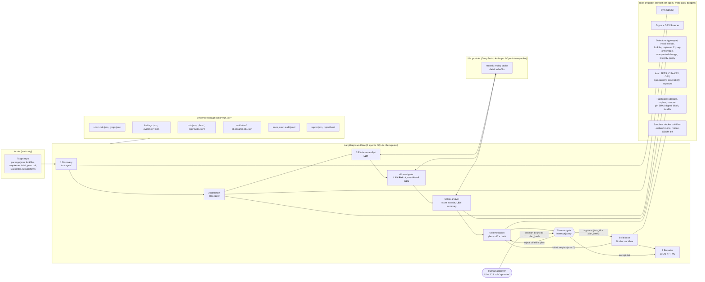

# Guardian architecture

Guardian is an agentic supply-chain guardian: it **discovers** what an application is built from, **detects**
vulnerable and suspicious components, **prioritises** them with an explainable score, **proposes** a safe fix,
waits for a **human approval**, then **validates** the fix in a sandbox and **reports** the evidence.

Everything below maps to the problem statement's five steps: Discover → Detect → Analyze → Remediate → Validate.

## 1. Agents, tools, data sources, AI interactions, approval points, evidence storage

Legend: **tool agents** (Discovery, Detection) never call an LLM, so facts cannot be hallucinated.
**Judgement agents** (Evidence analyst, Investigator, Risk analyst summary) call the LLM, and their output is
grounded against stored Evidence before it is saved. The **human gate** is the only way to the validator.

## 2. What each agent does

| # | Agent | Uses AI? | Input | Output |
|---|---|---|---|---|
| 1 | Discovery | no | target repo | work copy, resolved lockfiles (`--ignore-scripts`), CycloneDX SBOM, dependency graph with origin + integrity |
| 2 | Detection | no | SBOM, graph, files | Findings with Evidence: CVEs (Grype, OSV cross-check), typosquats, install scripts, missing lockfile, unpinned CI, tag-only images, unexpected changes, policy violations |
| 3 | Evidence analyst | yes | finding + its evidence (inside `<data>` blocks) | explanation, initial risk, claims labelled VERIFIED / INFERRED by code |
| 4 | Investigator | yes, ReAct | suspicious non-CVE findings | up to 8 read-only tool calls (registry metadata, file excerpt, manifest diff) and a labelled conclusion |
| 5 | Risk analyst | summary only | findings + EPSS, KEV, reachability, exposure, scope, provenance | `score = 100 × (0.30 S + 0.25 E + 0.20 R + 0.15 P + 0.10 X)`, band, confidence, computed in Python |
| 6 | Remediation | no (deterministic) | top findings + safe-version and compatibility evidence | one plan per attempt: ops, unified diff, target from evidence, expected risk reduction, rollback, `plan_hash` |
| 7 | Human gate | no | the saved plan | pauses (`interrupt()`); resumes only with an Approval for that `plan_id` and `plan_hash` |
| 8 | Validator | no | approved plan | applies it to a fresh copy, re-resolves lockfiles, builds and tests in Docker with no network, rescans, diffs SBOMs, re-runs detectors; verdict |
| 9 | Reporter | no | everything above | `report.json` (machine) and `report.html` (human) |

## 3. Approval points

1. **Before any change:** every plan stops at the human gate. The decision is bound to the plan's SHA-256
   hash: if the plan changed after it was shown, the approval does not apply (G5.1).
2. **Reject and accept risk need a written reason** (G5.2), and the reason is stored in `approvals.jsonl`.
3. **Who may decide:** with API tokens configured, only the `approver` role; the recorded `decided_by` is the
   authenticated identity, not a form field.
4. **Nothing is merged or pushed** (G5.5): a verified fix becomes a local branch with a `PR.md` in the attempt's
   copy. There is no tool for publish, push, merge or deploy (G3.4), and the harness greps for them.

## 4. Data sources

| Source | Used for | Offline behaviour |
|---|---|---|
| Syft, Grype, OSV-Scanner (pinned binaries in `tools/bin`) | SBOM, vulnerability matches | local DB |
| OSV API (`api.osv.dev`) | safe versions, advisories | disk cache |
| FIRST EPSS (`api.first.org`) | exploit probability | disk cache |
| CISA KEV (`www.cisa.gov`) | known exploited | disk cache |
| npm registry / PyPI | metadata, install scripts, maintainers, version heads | disk cache |
| GitHub (`git ls-remote`) | action tag → commit SHA | disk cache |
| Docker registries | image digests | disk cache |
| LLM provider | explanations, investigation, summaries | record / replay cache |

All outbound HTTP goes through `guardian/guardrails/network.py` (G3.5 host allowlist).
`GUARDIAN_OFFLINE=1` plus `GUARDIAN_LLM_MODE=replay` runs end to end with zero network calls (tested).

## 5. Evidence storage and audit

Every fact is an `Evidence` record (`runs/<id>/evidence/<ev_id>.json`) created by a tool, never by the LLM.
Findings, claims, risk factors and plans cite evidence ids. `trace.jsonl` holds every agent event (tool calls,
LLM calls, decisions D1..Dn, guardrail hits); `audit.jsonl` is the append-only audit log (G7.1).
LangGraph state is checkpointed in `runs/<id>/checkpoints.sqlite`, so a run paused at the gate can be resumed
by another process hours later.

## 6. Scalability

| Concern | Measure |
|---|---|
| Large dependency trees (Juice Shop: 1,656 components) | graph shows roots, direct deps and paths to findings only (§4.3); renders in well under 2 s |
| LLM cost | per-run caps on findings sent to the LLM and on tokens; record/replay cache |
| External APIs | disk cache, throttling, allowlist; batch EPSS (≤100 CVEs per call) |
| Many runs | runs are independent folders; API caps concurrent runs (`GUARDIAN_MAX_ACTIVE_RUNS`, HTTP 429) |
| Live trace | SSE reads `trace.jsonl` from a byte cursor (linear, not quadratic) |
| Sandbox | deps image cached by lockfile hash; CPU, memory, process and time limits per container |

## 7. Code map

| Area | Path |
|---|---|
| Workflow, state, run driver | `guardian/graph/` |
| Agents | `guardian/agents/` |
| Tools and detectors | `guardian/tools/` |
| Guardrails G1–G7 | `guardian/guardrails/` |
| LLM provider, record/replay | `guardian/llm/` |
| Data model (contract) | `guardian/core/models.py` |
| Reports | `guardian/reporting/` |
| API (FastAPI + SSE + auth) | `guardian/api/` |
| UI (React, React Flow) | `ui/` |
